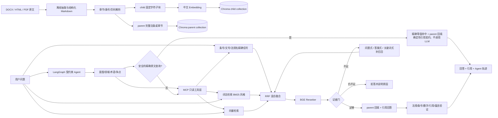

# JurisRAG：政府招标采购法规知识库

JurisRAG 是一个面向政府采购、工程招投标法规的可运行 Agentic RAG 项目。它把 DOCX、HTML、PDF 原文转换为带章节、条号、页码和 SHA-256 校验信息的结构化 Markdown，再建立父子块 Chroma 索引。证据层提供精确匹配、BM25、中文向量、RRF、BGE Reranker、HyDE 和父子块回填；MCP Server 将其拆成九个结构化只读工具；外层 LangGraph Agent 负责意图/领域/术语/争点识别、工具选择、多轮观察、覆盖检查、有限纠错、回答验证和预算内停止。原固定 Adaptive RAG 接口继续保留，用于基线和 MCP 故障降级。

这是一个用于学习、面试展示和内部检索实验的工程项目，不是法律意见系统。法规可能修订、废止或存在适用范围差异，任何实际业务结论都必须回到官方最新文本复核。

当前工程状态（2026-08-29）：代码已使用 Git 管理，`main` 保存稳定基线，优化在 `feat/observability-and-github-delivery` 分支按功能拆成独立 commit；发布清理后 44 项自动化测试通过。仓库尚未配置 GitHub remote，也尚未在 GitHub Actions 上实际运行，不能把本地验证写成远程 CI 已通过。

面试与优化说明：

- [简历项目描述（STAR 法则）](docs/简历项目描述_STAR.md)：提供可直接用于简历的项目描述、面试展开方式和标注全部优化节点的架构图。
- [RAG 全部优化记录](docs/RAG优化全记录.md)：逐项记录初始问题、修改措施、真实评测结果、代价和证据边界。
- [受约束法律检索 Agent 详细开发计划](docs/Agent架构详细开发计划.md)：从意图识别、MCP 工具路由、循环约束、证据验证、有限纠错到 A/B 评测的逐阶段实施方案。

## 1. 已迁移内容和当前规模

本目录只保留运行所需的实现代码、评测代码、原始法规、结构化 Markdown 和 Chroma 数据库；没有复制虚拟环境、IDE 配置、临时目录、评测大结果文件或模型缓存。

当前本地工作区的数据库已经可以直接读取；`data/index/` 不提交 GitHub，其他人克隆后应按离线流程重建：

| 内容 | 数量 | 说明 |
| --- | ---: | --- |
| 主清单法规 | 20 | `data/source/primary_laws/manifest.json` 登记的基线语料 |
| 合并后的法规文档 | 66 | 主清单与法律汇集去重后的入库文档 |
| parent 块 | 1,565 | 通常对应完整法条或普通章节，供回答和溯源 |
| child 块 | 2,299 | 参与精细检索的短块 |
| 向量模型 | BGE-small-zh-v1.5 | 512 维中文 Embedding |
| 重排模型 | bge-reranker-base ONNX | 对前 20 个候选 child 重排 |

开发集上曾得到以下结果，仅表示当前数据集和配置下的开发集表现：50 道有答案问题的 Recall@1=0.62、Recall@3=0.85、Recall@5=0.95、MRR@5=0.753，错误拒答 0/50；10 道无答案问题正确拒答 10/10。它们不能外推为生产环境准确率。

## 2. 系统架构



核心代码分工如下：

- `offline_ingestion/`：读取原文、审计清单、转换 Markdown、父子切块和写入 Chroma。
- `online_retrieval/`：问题信号提取、词法/向量混合检索、RRF、重排、证据门和回答。
- `legal_mcp/`：把精确、关键词、语义、HyDE、多查询、父块、适用范围、溯源和争点覆盖能力注册为 MCP 工具。
- `agent/`：LangGraph 状态、结构化意图、工具策略、MCP Client、预算约束、证据合并、回答验证和固定 RAG 降级。
- `shared/`：统一配置、数据模型、Embedding、Reranker、Chroma 存储。
- `evaluation/`：gold 数据审计、Recall/MRR 评测、拒答评测和可选 Ragas 上下文评测。
- `scripts/download_models.py`：下载并校验两个 ONNX 模型，不把模型权重提交到项目。

## 3. 目录说明

```text
JurisRAG/
├─ data/
│  ├─ source/
│  │  ├─ primary_laws/              # 主项目原始 DOCX/HTML/PDF、manifest.json
│  │  └─ legal_collection/          # 外部法律汇集原文件、清单、SHA256SUMS
│  ├─ processed/
│  │  ├─ markdown/                  # primary_laws 派生 Markdown
│  │  └─ legal_collection/          # 法律汇集派生 Markdown和转换审计报告
│  └─ index/legal_knowledge/         # 已生成的 Chroma 持久化数据库
├─ offline_ingestion/
├─ online_retrieval/
├─ agent/                             # LangGraph 单 Agent 控制层
├─ legal_mcp/                         # MCP 协议适配与只读工具业务层
├─ shared/
├─ scripts/
├─ evaluation/
├─ .env.example
├─ requirements.txt
├─ run_api.py
├─ run_mcp.py
└─ README.md
```

`data/source` 是原文唯一存放位置。Markdown 是派生物，不应手工修改后继续沿用旧审计报告；修改原文或 Markdown 后，应重新转换、审计和建索引。每个 chunk 的 metadata 都保存法规标题、分类、原文件名、来源网址、文号、SHA-256、章节、条号、页码范围、Markdown 文件、parent ID 和 child ID。

## 4. 环境准备

建议使用 CI 固定的 Python 3.12；当前 Windows 工作区也已在 Python 3.14 验证。Windows PowerShell 在项目根目录执行：

```powershell
cd 'D:\面试面经\项目\JurisRAG'
py -3.12 -m venv .venv
.\.venv\Scripts\python.exe -m pip install -r requirements.txt
```

如果要运行评测脚本，再安装 Ragas：

```powershell
.\.venv\Scripts\python.exe -m pip install -r evaluation\requirements-eval.txt
```

复制配置模板：

```powershell
Copy-Item .env.example .env
```

默认 `ENABLE_LLM=false`，因此不需要 API Key 也可以完成离线入库、在线检索和证据式回答。只有想使用 DeepSeek 生成最终答案或 LLM 检索改写时，才在 `.env` 中填写自己的 `DEEPSEEK_API_KEY`；不要把真实 `.env` 提交到 Git。

## 5. 模型准备

当前 Chroma 数据库中已经有向量，但在线重新查询仍需要本地 Embedding 模型；启用重排也需要 Reranker。模型约 380 MB，默认写入 `data/models/`，该目录已加入 `.gitignore`：

```powershell
.\.venv\Scripts\python.exe scripts\download_models.py
```

模型下载脚本固定了 Hugging Face revision，并对 Reranker ONNX 文件做 SHA-256 校验。网络受限时可在 PowerShell 先设置镜像：

```powershell
$env:HF_ENDPOINT='https://hf-mirror.com'
.\.venv\Scripts\python.exe scripts\download_models.py
```

如果模型放在别处，可在 `.env` 中把 `EMBEDDING_MODEL_PATH` 和 `RERANKER_MODEL_PATH` 改成绝对路径，或填写相对于项目根目录的路径。

## 6. 直接启动和调用

必须从项目根目录启动。代码对 Windows 中文目录做了兼容处理：Chroma 实际收到的是项目内 ASCII 相对路径，数据库实体仍然位于 `data/index/legal_knowledge`。这样可避免大 HNSW 索引跨进程重启时的路径编码问题。

固定 RAG 只需启动 API；Agent 模式需要先启动独立 MCP Server，再启动 API：

```powershell
# PowerShell 窗口 1：MCP 工具服务
.\.venv\Scripts\python.exe run_mcp.py --transport streamable-http --port 8001

# PowerShell 窗口 2：Web 与两种问答 API
.\.venv\Scripts\python.exe run_api.py
```

启动后可以直接打开 Web 问答界面：

- `http://127.0.0.1:8000/`：面向用户的法规问答页面；
- `http://127.0.0.1:8000/docs`：FastAPI 自动生成的接口调试页；
- `http://127.0.0.1:8000/live`：只检查 API 进程是否存活，不访问外部依赖；
- `http://127.0.0.1:8000/health`：知识库、索引和本地模型健康检查；
- `http://127.0.0.1:8000/ready`：聚合固定 RAG 与 Agent 就绪状态；核心索引不可用时返回 HTTP 503；
- `http://127.0.0.1:8000/api/v1/agent/health`：LLM、MCP 和九个工具健康检查。

Web 页面与 API 使用同一个 FastAPI 进程，不需要安装 Node.js。页面支持“Agent RAG / 固定 RAG”切换、Top-K、证据不足提示、法条展开、官方来源和公开 Agent 轨迹。

另开 PowerShell 检查服务：

```powershell
Invoke-RestMethod http://127.0.0.1:8000/health
```

预期主要字段为 `indexed_children: 2299`、`indexed_parents: 1565`。查询接口：

```powershell
$body = @{ question = '政府采购法第二十二条规定了哪些供应商条件？'; top_k = 3 } | ConvertTo-Json
Invoke-RestMethod -Method Post -Uri http://127.0.0.1:8000/api/v1/questions `
  -ContentType 'application/json' -Body $body
```

Agent 接口使用相同问题字段，并额外支持是否返回逐节点事件：

```powershell
$agentBody = @{
  question = '招标文件约定投标文件超过150页可以否决，合法吗？'
  top_k = 3
  debug_trace = $true
} | ConvertTo-Json
Invoke-RestMethod -Method Post -Uri http://127.0.0.1:8000/api/v1/agent/questions `
  -ContentType 'application/json' -Body $agentBody
```

返回对象包含：

- `answer`：LLM 生成答案或不依赖外部模型的原文证据式回答；
- `citations`：法规标题、条号/章节、页码、原文片段、来源网址、parent/child ID；
- `retrieval_trace`：各通道、候选数量、阈值、是否二次召回、证据门判断；
- `insufficient_evidence`、`refusal_reason`：证据不足时明确拒答；
- `generation_mode`：`retrieval_fallback`、`llm` 或 `abstention`。

## 7. MCP 法律检索工具

MCP 层使用官方 Python SDK。它不修改知识库，只把已有能力拆成 Agent 可以按需选择的九个白名单工具：

| MCP 工具 | 输入重点 | 输出/用途 |
| --- | --- | --- |
| `exact_legal_search` | 法规名、条号、文号 | 多字段同时精确命中的 child 法条 |
| `keyword_search` | 准确术语、数字、行为关键词 | BM25 child 候选 |
| `semantic_search` | 自然语言或同义表达 | BGE 向量 child 候选 |
| `hyde_search` | 完整问题 | 中性假设答案检索结果；假设文本不能作为证据 |
| `multi_query_search` | 最多五个争点查询 | 多路 BM25+向量、RRF、Reranker 结果 |
| `fetch_parent_context` | 检索结果中的 `parent_id` | 完整法条或章节 |
| `lookup_document_scope` | 法规名或文号 | 类别、效力状态、日期、官方来源等库内元数据 |
| `get_source_metadata` | child/parent ID | 条号、页码、原文件、Markdown 和官方链接 |
| `check_issue_coverage` | 问题与证据 ID | 争点覆盖、可回答性、缺失证据和建议查询 |

给本机 Agent 作为子进程使用时，推荐 `stdio`，不会额外开放端口：

```powershell
cd 'D:\面试面经\项目\JurisRAG'
.\.venv\Scripts\python.exe run_mcp.py --transport stdio
```

需要让独立客户端连接或调试时，可启动 Streamable HTTP：

```powershell
.\.venv\Scripts\python.exe run_mcp.py --transport streamable-http --port 8001
```

MCP 地址为 `http://127.0.0.1:8001/mcp`。协议返回 `structuredContent`，不是让 Agent 二次解析的一段自由文本；九个工具都声明了 `readOnlyHint=true`、`destructiveHint=false`、`idempotentHint=true` 和 `openWorldHint=false`。`top_k` 被限制为 1～20，多查询最多五条，一次读取 ID 最多二十个，避免 Agent 无界占用上下文。

Agent 已通过官方 MCP Client 调用此服务，没有直接绕过协议访问 `legal_mcp.service`。HTTP 是默认部署方式，内存 MCP 会话只用于协议测试。

## 8. 受约束 Agent 控制层

Agent 状态图依次执行：输入校验 → 意图/领域/术语/争点识别 → 动作策略 → MCP 调用 → 证据观察与去重 → 争点覆盖 → 按需继续检索 → parent 回填 → 回答 → 确定性和 LLM 双重审查 → 完成、安全原文回退或拒答。

主要工程边界：

- 最多 3 轮检索、8 次 MCP 调用、7 次可计数模型调用和 2 次纠正；
- 第一轮按正式引用和意图确定性路由，后续根据覆盖缺口切换未使用通道；
- 动作使用“工具名 + 规范 JSON 参数”的 SHA-256 签名，完全重复调用被拦截；
- Agent 只能选择六个搜索/范围工具，覆盖检查和 parent 回填由状态图固定执行；
- HyDE 文本不进入证据和引用；
- 回答检查法规名、条号、文号、数字、citation ID 和证据蕴含；
- 模型回答连续两次不通过时，撤销模型结论并保留带引用的原文证据；
- MCP 不可连接时显式降级到原固定 Adaptive RAG；
- 问题最长 2,000 字，模型列表、工具参数、MCP structuredContent 和最终响应都经过分层 Schema/契约校验；
- 单次 LLM 35 秒、MCP 会话 30 秒、Agent 图 90 秒、端到端请求 120 秒，超时后确定性降级或失败关闭；
- MCP 连接最多尝试 2 次，连续 3 次连接失败后熔断 30 秒；工具错误和响应错误不会被当作网络错误重复执行；
- 进程内最多并行 2 个 Agent 请求，超过容量快速返回 HTTP 503 和 `Retry-After`，保护 CPU Reranker 和外部模型；
- 直接/条件式回答必须有不重复的可追溯引用，证据不足拒答不得携带伪支持引用；出站契约不一致时改为安全拒答；
- 每个 HTTP 响应返回 `X-Request-ID` 和 `X-Process-Time-Ms`，日志不记录问题正文、密钥或 Authorization Header；
- Web 只展示公开决策摘要、工具和状态变化，不展示隐藏思维链。
- 对“明确法规名 + 明确条号 + 无法律评价”的单一原文查询启用严格快速路径，只执行精确检索和 parent 回填；出现“合法吗、能否、是否有效、责任、救济”等表达时强制走完整 Agent。
- `agent_trace.llm_usage` 按节点记录模型名、供应商返回的 Token、耗时和成功/失败；供应商不返回 Token 时保留 `null`，且不记录 prompt、回复正文或密钥。

这些是当前单进程可验证的可靠性措施，不等同于分布式高可用。多实例部署仍需要反向代理/网关、进程守护、全局限流、共享指标与告警；当前项目没有虚构 Kubernetes、Redis 或自动故障转移能力。

完整实现与验收计划见 `docs/Agent架构详细开发计划.md`。

## 9. 离线入库流程

主语料已经带有结构化 Markdown。如果新增或替换主清单中的原文：

```powershell
.\.venv\Scripts\python.exe -m offline_ingestion.markdown_converter.convert_corpus
.\.venv\Scripts\python.exe -m offline_ingestion.markdown_converter.audit_markdown
.\.venv\Scripts\python.exe -m offline_ingestion.build_index
```

法律汇集的原文在 `data/source/legal_collection`，转换结果写入 `data/processed/legal_collection`：

```powershell
.\.venv\Scripts\python.exe -m offline_ingestion.markdown_converter.convert_legal_collection
.\.venv\Scripts\python.exe -m offline_ingestion.build_index
```

`build_index` 会先检查原文 SHA-256、Markdown front matter、转换审计报告、来源路径和 Markdown SHA-256，审计失败时不会删除旧集合。默认重建当前 child/parent 两个集合；如果只想测试 primary 20 份语料，可在 `.env` 设置 `INCLUDE_LEGAL_COLLECTION=false`。

## 10. 在线检索的具体步骤

1. `_query_signals` 提取法规名、条号、文号、数字和关键实体。短问题中出现准确编号时，精确匹配会提高对应 child 的分数。
2. 词法通道使用中文 token 和倒排统计，适合“第22条”“财政部令第87号”等准确表达。
3. 向量通道使用 BGE-small-zh-v1.5，适合同义改写和自然语言表达。
4. 每个通道先取 `top_k * HYBRID_CANDIDATE_MULTIPLIER` 个候选，至少 20 个；再使用 `1 / (RRF_K + rank)` 做 Reciprocal Rank Fusion。
5. 对融合后的前 `RERANK_CANDIDATES` 个 child 使用 BGE Reranker；按 `parent_id` 去重并回填完整 parent 法条/章节。
6. 证据门综合 Reranker 分数、加权词项覆盖、通道一致性和正式条号命中，不只依赖一个模型分数。
7. 初次证据不足且 `ENABLE_MULTI_RECALL=true` 时，生成三种只用于检索的表达：问题式、答案式（HyDE）和关键词式。LLM 未配置时使用安全的确定性改写，不会虚构条号或金额。
8. 二次召回仍不满足证据门时，返回拒答，不调用最终回答模型，也不把不充分候选伪装成引用。

## 11. 全部重要参数

所有参数集中在 `shared/config.py`，`.env.example` 给出了可复制的模板。

| 参数 | 默认值 | 作用和调节建议 |
| --- | --- | --- |
| `INCLUDE_LEGAL_COLLECTION` | `true` | 是否把 `data/source/legal_collection` 的合规汇集并入索引。关闭可做 20 份基线对照。 |
| `RAW_LAWS_DIR` | `data/source/primary_laws` | 主清单原始文件目录。相对路径相对于项目根目录。 |
| `PROCESSED_MARKDOWN_DIR` | `data/processed/markdown` | 主清单 Markdown 输出目录。 |
| `LEGAL_COLLECTION_SOURCE_DIR` | `data/source/legal_collection` | 外部汇集原文目录。 |
| `LEGAL_COLLECTION_MARKDOWN_DIR` | `data/processed/legal_collection` | 外部汇集 Markdown 和审计报告目录。 |
| `INDEX_DIR` | `data/index/legal_knowledge` | Chroma 持久化数据库目录。 |
| `EMBEDDING_BACKEND` | `bge_small_zh_v1_5` | `bge_small_zh_v1_5` 使用中文模型；`hash` 仅用于无模型消融，不要与现有 BGE 数据库混用。 |
| `EMBEDDING_MODEL_NAME` | `BAAI/bge-small-zh-v1.5` | Embedding 的逻辑模型名，记录实验配置。 |
| `EMBEDDING_MODEL_PATH` | `data/models/fastembed/...` | 本地 FastEmbed snapshot 路径。 |
| `EMBEDDING_BATCH_SIZE` | `64` | 离线向量批大小。显存/内存不足时降低。 |
| `RERANKER_BACKEND` | `bge_reranker_base_onnx` | `none` 可关闭重排，适合做消融实验。 |
| `RERANKER_MODEL_PATH` | `data/models/bge-reranker-base` | Reranker 本地目录。 |
| `RERANK_CANDIDATES` | `20` | 融合后送入交叉编码器的 child 数。增大通常提高精排覆盖，但增加延迟。 |
| `CHUNK_SIZE` | `500` | child 固定字符上限。法条先按结构成为 parent，再对过长 parent 切 child。 |
| `CHUNK_OVERLAP` | `80` | 相邻 child 重叠字符数，必须小于 `CHUNK_SIZE`。 |
| `DEFAULT_TOP_K` | `5` | API 未指定 `top_k` 时返回的去重 parent 数。API 限制为 1~10。 |
| `HYBRID_CANDIDATE_MULTIPLIER` | `8` | 每个检索通道候选数约为 `top_k * 8`，同时至少 20。 |
| `RRF_K` | `60` | RRF 平滑常数。越大越不强调名次差距。 |
| `ENABLE_MULTI_RECALL` | `true` | 证据不足时是否执行补召回。 |
| `RETRY_RERANKER_SCORE` | `5.0` | 低于该分数时，结合覆盖率判断是否需要二次召回。是当前模型分数阈值，不是概率。 |
| `EVIDENCE_MIN_RERANKER_SCORE` | `3.0` | 证据门接受普通候选的最低重排分数之一。 |
| `EVIDENCE_MIN_WEIGHTED_COVERAGE` | `0.20` | 关键问题词在候选证据中的最低加权覆盖比例。 |
| `EVIDENCE_MIN_CHANNEL_AGREEMENT` | `2` | 至少需要多少检索通道支持同一候选。 |
| `ENABLE_LLM` | `false` | 是否调用 DeepSeek 生成最终自然语言答案和 LLM 检索改写。关闭时完全离线。 |
| `DEEPSEEK_API_KEY` | 空 | 用户自己的密钥，只存在 `.env`，禁止提交。 |
| `DEEPSEEK_BASE_URL` | 空 | 可选兼容 OpenAI 风格的服务地址。 |
| `DEEPSEEK_MODEL` | `deepseek-chat` | 最终回答/查询改写模型名。温度在代码中固定为 0。 |
| `ENABLE_AGENT` | `true` | 是否开放 Agent 接口。关闭不影响固定 RAG。 |
| `MCP_SERVER_URL` | `http://127.0.0.1:8001/mcp` | Agent 使用的 Streamable HTTP MCP 地址。 |
| `AGENT_MAX_ITERATIONS` | `3` | 最多检索轮数。 |
| `AGENT_MAX_TOOL_CALLS` | `8` | 包含搜索、覆盖检查和 parent 回填的 MCP 总预算。 |
| `AGENT_MAX_LLM_CALLS` | `7` | 意图、MCP 规划、回答和审查的可计数模型预算。 |
| `AGENT_MAX_CORRECTIONS` | `2` | 工具参数或答案失败后的最大纠正数。 |
| `AGENT_MAX_CHILD_EVIDENCE` | `20` | 状态内 child 证据上限。 |
| `AGENT_MAX_PARENT_EVIDENCE` | `8` | 回答上下文 parent 上限。 |
| `AGENT_MAX_CITATIONS` | `5` | 最终主要引用上限。 |
| `AGENT_TIMEOUT_SECONDS` | `90` | 单次 Agent 图运行时间预算。 |
| `AGENT_REQUEST_TIMEOUT_SECONDS` | `120` | 包含显式降级在内的端到端请求上限。 |
| `AGENT_LLM_TIMEOUT_SECONDS` | `35` | 单次意图、规划、回答或审查模型调用上限。 |
| `AGENT_BASELINE_TIMEOUT_SECONDS` | `25` | MCP/Agent失败后固定 RAG 降级的独立上限。 |
| `AGENT_MCP_TIMEOUT_SECONDS` | `30` | 单次 MCP 会话超时。 |
| `AGENT_MCP_RETRY_ATTEMPTS` | `2` | 连接/超时故障的总尝试次数，包含首次调用。 |
| `AGENT_MCP_CIRCUIT_FAILURE_THRESHOLD` | `3` | 连续多少次连接失败后开启熔断。 |
| `AGENT_MCP_CIRCUIT_RECOVERY_SECONDS` | `30` | 熔断冷却后允许半开探测的等待时间。 |
| `AGENT_HEALTH_TIMEOUT_SECONDS` | `10` | MCP工具发现健康探测上限，不调用LLM。 |
| `AGENT_NO_PROGRESS_LIMIT` | `2` | 连续无新增证据后停止。 |
| `AGENT_TOOL_TOP_K` | `5` | Agent 单工具默认 Top-K，第一版最多 10。 |
| `AGENT_MAX_CONCURRENT_REQUESTS` | `2` | 单 API 进程同时运行的 Agent 请求数。 |
| `AGENT_MAX_QUESTION_CHARS` | `2000` | 用户问题最大字符数。 |
| `AGENT_EXACT_REFERENCE_FAST_PATH` | `true` | 是否允许严格的法规名+条号原文快速路径；不处理合法性评价。 |
| `AGENT_EXACT_FAST_PATH_USE_LLM` | `false` | 快速路径是否再进入生成模型；默认关闭，直接返回可追溯原文。 |

修改 Embedding 模型、向量维度或集合版本后必须重新建库；不要把不同维度的向量写入同一 Chroma collection。

## 12. Git、CI 与容器交付

项目采用 `main` 稳定基线加短期功能分支。推荐提交前执行：

```powershell
git status
git diff --check
.\.venv\Scripts\python.exe -m pytest -q
.\.venv\Scripts\python.exe -m pip check
git diff --cached
```

`.gitignore`、`.dockerignore` 和 CI 都会排除 `.env`、模型、Chroma 索引、日志和临时评测输出。`.github/workflows/ci.yml` 不调用付费模型，而是用 Hash Embedding、关闭 Reranker、从已提交 Markdown 创建临时索引后运行完整测试。该流程已在本地以相同环境变量验证；只有推送 GitHub 并出现成功的工作流记录后，才能称为“GitHub Actions CI 通过”。

本地已有模型和索引时可使用：

```powershell
docker compose config
docker compose up --build
```

API 为 `http://127.0.0.1:8000`，MCP 为 `http://127.0.0.1:8001/mcp`。镜像不包含模型和索引，Compose 通过 volume 挂载 `data/models` 与 `data/index`；真实 `.env` 只在运行时注入。当前 Compose 配置解析通过；2026-08-27 的首次镜像构建在下载 Dockerfile 前端层时因 Docker Hub 速度过慢被人工中止，尚未进入项目依赖安装，因此容器端到端启动仍待网络恢复后验收。

协作和安全规则分别见 [CONTRIBUTING.md](CONTRIBUTING.md)、[SECURITY.md](SECURITY.md) 与 [DATA_NOTICE.md](DATA_NOTICE.md)。软件代码使用 MIT License；第三方法规文件不由 MIT License 再授权。

创建空的 GitHub 仓库后再执行以下命令；`<你的仓库URL>` 必须替换为真实地址，本项目目前没有擅自配置远程仓库：

```powershell
git remote add origin <你的仓库URL>
git push -u origin main
git push -u origin feat/observability-and-github-delivery
```

建议先在 GitHub 对功能分支发起 Pull Request，等待 Actions 真实通过后再合并 `main`，不要在本地把未远程验证的工作流描述成成功。

## 13. 评测

先审计 gold 数据与当前来源：

```powershell
.\.venv\Scripts\python.exe -m evaluation.audit_gold_dataset
```

运行有答案召回评测：

```powershell
.\.venv\Scripts\python.exe -m evaluation.run_retrieval_eval `
  --dataset evaluation/datasets/legal_rag_gold_v2.jsonl `
  --output evaluation/results/retrieval_latest.json `
  --top-k 5
```

运行无答案拒答评测：

```powershell
.\.venv\Scripts\python.exe -m evaluation.run_abstention_eval `
  --dataset evaluation/datasets/legal_rag_unanswerable_v1.jsonl `
  --output evaluation/results/abstention_latest.json `
  --top-k 5
```

如已安装 `ragas` 并配置了可用的评测 LLM，可对已有检索输出运行上下文评测：

```powershell
.\.venv\Scripts\python.exe -m evaluation.run_ragas_context_eval
```

最终版本还提供五项生成质量评测脚本：

```powershell
.\.venv-eval\Scripts\python.exe -m evaluation.run_ragas_full_eval --concurrency 3
```

本轮实际运行因 DeepSeek 评测账户余额不足而部分完成：50/50题成功生成答案，42/50题完成全部五项评分。当前成功样本上的均值为 Context Precision 0.9112（43题）、Context Recall 0.9545（44题）、Faithfulness 0.9756（43题）、Answer Relevancy 0.9330（43题）、Factual Correctness 0.2638（42题）。缺失题不是0分，不能把这些均值写成完整50题最终结果。详细状态见 `evaluation/results/ragas_full_final_v2.md`。

充值后直接再次运行同一命令即可：生成答案和成功指标均已缓存，脚本只重跑缺失或失败的题。只根据缓存重建报告可执行：

```powershell
.\.venv-eval\Scripts\python.exe -m evaluation.run_ragas_full_eval --report-only
```

Factual Correctness 偏低还暴露了 gold 数据粒度问题：人工参考答案平均约34字，而生成答案平均约399字。大量证据支持的具体条件没有写进简短参考答案，RAGAS 的事实 F1 会将这些额外事实判为未与参考答案匹配。因此下一步应先由人工依据 gold 法条扩写参考答案，再冻结数据集重新评测，不能通过删减正确答案来迎合分数。

Agent 新增 10 题工程冒烟集，检查领域、可回答性、首个工具、预算终止、重复调用、引用和禁止性表述。它不是法律权威正确率：

```powershell
.\.venv\Scripts\python.exe -m evaluation.run_agent_eval --limit 1
```

全部十题会产生较多模型调用，应在 MCP 服务和模型额度正常时运行。结果默认写入 `evaluation/results/legal_agent_smoke_v1.json`。固定 RAG 与 Agent 的完整冻结 A/B 评测尚未完成，因此 README 不声明 Agent 带来了量化质量提升。

评测集是开发集，不能代替时间切分、法规版本切分、人工法律审核和线上监控。建议后续增加：废止/修订版本测试、跨法规冲突测试、页码溯源准确率、拒答安全率、延迟和模型下载失败降级测试。

## 14. 常见问题

**为什么不能直接把 HTML 当作最终知识？** HTML 是原始来源格式，网页标签、导航和附件关系不适合直接检索。项目先保留 HTML 原文件，再生成带 front matter 和结构标题的 Markdown；原文 SHA-256 让每个 chunk 可以回到确切文件。

**为什么回答返回 parent 而不是命中的 child？** child 用来精确定位，parent 保留完整法条或章节上下文。响应中的 `matched_child_chunk_id` 和 `matched_child_quote` 仍会告诉你是哪一个 child 触发了召回。

**为什么证据不足时不直接让大模型猜？** 法律问答的错误自信比空回答更危险。证据门、二次多路召回和最终拒答共同约束回答；即使启用 LLM，模型也只能看到通过证据门的文本。

**为什么 `.gitignore` 忽略 `data/models` 和 `data/index`？** 模型和索引通常体积较大，面试项目可以保留本地运行副本，但不适合直接提交到普通 Git 远程。若需要交付完整离线包，请把这两个目录单独压缩或使用 Git LFS，并同时保留 README 中的版本和校验说明。

## 15. 法律与数据免责声明

本项目仅用于信息检索和工程学习。数据文件中的来源网址、发布日期、法律状态和 SHA-256 只描述本次收集到的文件，不保证当前仍然有效。涉及招标采购资格、程序期限、投诉救济、处罚责任或合同争议时，应核对国家法律法规数据库、中国政府采购网、国家发展改革委等官方最新记录，并由有资质的专业人员作出判断。
