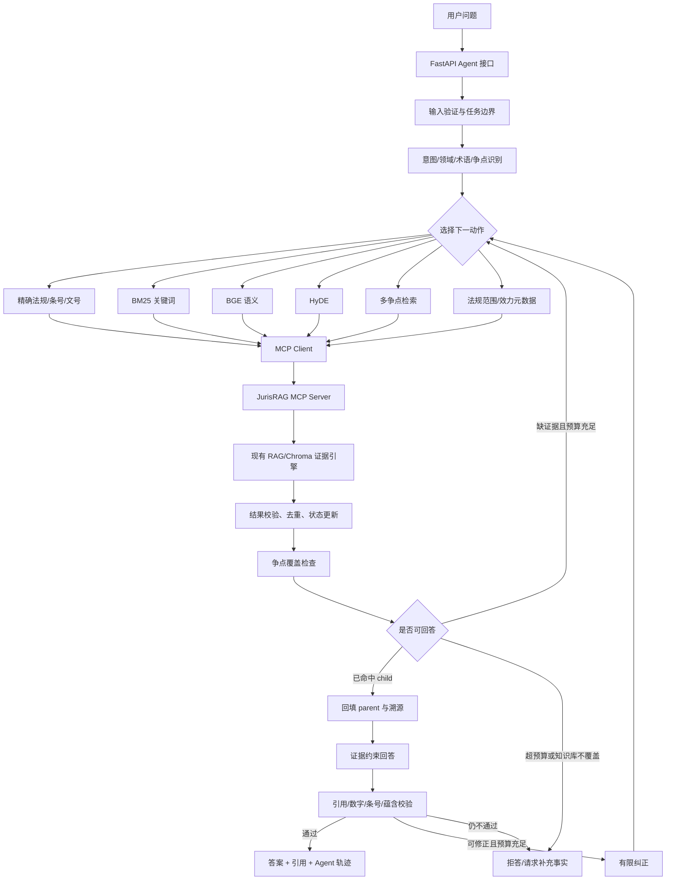

# JurisRAG 受约束法律检索 Agent：详细开发计划

> 历史方案：本计划及完成标记对应轻量重构前版本。当前使用单进程有限循环、SQLite FTS5 和可选 MCP，见 README 与 docs/项目设计与实现说明.md；这里的依赖、预算和工具数量均不作为当前验收依据。

> 文档状态：第一版后端、MCP、Web 和工程冒烟评测入口已实现；完整冻结 A/B 评测待运行  
> 适用项目：`D:\面试面经\项目\JurisRAG`  
> 目标读者：第一次实现 Agent 的开发者、代码评审者、面试官  
> 核心原则：现有 RAG 是证据引擎，MCP 是工具协议，Agent 只负责受约束地规划、调用、观察、验证和停止。

## 1. 文档目的

本文档把 JurisRAG 从当前的“自适应 RAG + MCP 工具层”扩展为“受约束的单 Agent 法律检索系统”。计划覆盖从用户输入到最终答案的完整工程链路：

1. 输入安全检查与任务边界识别；
2. 意图、领域、术语和法律争点识别；
3. 根据当前证据缺口选择 MCP 工具；
4. 执行工具、观察结果、去重并更新状态；
5. 判断证据能否直接回答、条件式回答或必须拒答；
6. 对无结果、错误工具、错误参数、证据冲突和模型输出失败进行有限纠正；
7. 生成只依赖检索证据的法律信息回答；
8. 校验法规名称、条号、数字、引用和结论蕴含关系；
9. 输出答案、证据、停止原因和可审计 Agent 轨迹；
10. 使用同一评测集比较固定 RAG 与 Agent RAG，证明改造是否真的有效。

本文档既是开发计划，也是第一版验收清单。当前已经实现 RAG、九个 MCP 工具、LangGraph 状态图、Agent API、Web 模式切换、约束/验证/安全回退以及 10 题工程冒烟评测入口；尚未完成的是完整困难集扩充和固定 RAG 与 Agent RAG 的冻结 A/B 质量评测。因此本文中的目标指标仍不能当作实测提升。

## 2. 当前基线与改造边界

### 2.1 当前已经具备的能力

现有系统已经提供：

- DOCX、HTML、PDF 到结构化 Markdown 的离线转换；
- 章节、法条、页码、来源链接、SHA-256 和 parent/child ID 元数据；
- 父子切块，child 精细检索后回填 parent 完整法条或章节；
- 中文 BGE Embedding、BM25 风格词法检索、精确条号/文号匹配；
- RRF 融合和 BGE Reranker；
- 问题式、HyDE 答案式和关键词式补召回；
- 证据不足拒答、引用检查和回答审查；
- FastAPI 与 Web 问答页面；
- MCP Server 和九个结构化只读工具；
- RAGAS、Recall/MRR 和拒答评测脚本。

以上能力是 Agent 改造前保留的固定 RAG 基线。当前项目已在其外层实现 LangGraph 请求内状态机；模型可以根据上一轮证据缺口建议下一项 MCP 工具，但最终动作仍受白名单、参数 Schema、重复签名、轮数和时间预算约束。固定调用链没有删除，继续用于基线对照和 MCP 故障降级。

### 2.2 本次要新增的能力

本次新增一个外层单 Agent 控制器，使其能够：

- 识别问题属于精确查法条、规则解释、合法性评价、程序咨询、适用范围判断或证据不足型问题；
- 区分政府采购、工程建设招投标和领域不确定；
- 把“甲方”等口语映射成候选法律主体，但不在场景不明时擅自确定；
- 把复杂问题拆成多个法律争点；
- 根据当前证据缺口选择 MCP 工具和参数；
- 观察工具结果后决定停止、换查询、换工具、补父块、查适用范围或拒答；
- 对重复调用、错误参数、工具异常、无新增证据和错误引用进行有限纠正；
- 保留结构化执行轨迹，支持调试、Web 展示和评测。

### 2.3 明确不做的内容

第一版不实现：

- 多 Agent 辩论、角色协作或 Agent 间自由通信；
- 自由互联网搜索、Shell、数据库写入或法规自动更新；
- 无限制 ReAct 循环；
- 长期用户画像和跨会话记忆；
- 自动作出“保证合法”“一定违法”等无条件法律意见；
- 把 HyDE 假设答案、模型记忆或工具选择理由当作法律证据；
- Redis、消息队列、微服务拆分和复杂权限平台。

第一版的核心是一个可测、可停止、可解释的单 Agent 闭环。

## 3. 总体架构



系统保持三层职责分离：

| 层 | 主要模块 | 只负责什么 | 不负责什么 |
| --- | --- | --- | --- |
| RAG 证据层 | `online_retrieval/`、`shared/` | 召回、融合、重排、父子回填 | 不决定多轮策略 |
| MCP 工具层 | `legal_mcp/` | 工具发现、参数 Schema、结构化返回 | 不决定下一个工具 |
| Agent 控制层 | 计划新增 `agent/` | 状态、路由、停止、纠错、回答验证 | 不直接操作 Chroma |

## 4. 技术选型

### 4.1 推荐选型

- 状态编排：LangGraph；
- 模型客户端：继续复用 `shared/llm.py` 中的 DeepSeek/DashScope 配置；
- MCP 客户端：优先直接使用官方 `mcp` Python SDK 的 Streamable HTTP Client；
- MCP Server：复用已有 `legal_mcp/server.py`；
- API：复用 FastAPI；
- 数据校验：Pydantic；
- 状态持久化：第一版仅请求内内存状态；
- 测试：Pytest + Mock LLM + 内存 MCP 会话 + 真实本地 Chroma；
- 评测：现有检索评测、拒答评测、RAGAS，加上 Agent 专项指标。

不直接使用完全自由的 `create_react_agent()` 作为主实现。第一版采用显式 StateGraph 节点：每个节点的输入、输出、路由条件和最大重试次数都写入代码。这样更容易解释，也更适合法律场景。

### 4.2 MCP 传输方式

开发和部署默认使用 Streamable HTTP：

```text
Agent API : http://127.0.0.1:8000
MCP Server: http://127.0.0.1:8001/mcp
```

理由：

- Agent 和 RAG 工具边界真实经过 MCP 协议，而不是在同一进程偷调 Python 函数；
- MCP 服务可以独立健康检查和协议测试；
- Agent API 重启不会重建工具定义；
- Web 和面试演示更容易展示调用链。

单元测试使用官方 SDK 的内存 MCP 会话，避免每个测试都占端口。`stdio` 保留给桌面客户端或本机子进程集成。

### 4.3 新依赖处理

实施阶段先在当前 Python 3.14 虚拟环境验证 LangGraph 兼容版本，再把实际安装成功的精确版本写入 `requirements.txt`。不能先在文档中虚构版本号。依赖验收必须包括：

```powershell
.\.venv\Scripts\python.exe -m pip check
.\.venv\Scripts\python.exe -c "import langgraph, mcp; print('imports ok')"
```

## 5. 建议目录结构

```text
JurisRAG/
├─ agent/
│  ├─ __init__.py
│  ├─ state.py                 # LegalAgentState 与状态辅助函数
│  ├─ schemas.py               # 意图、动作、覆盖、验证等 Pydantic Schema
│  ├─ config.py                # Agent 预算与开关
│  ├─ graph.py                 # LangGraph 节点注册、边和编译
│  ├─ service.py               # run_agent(question) 对外业务入口
│  ├─ mcp_client.py            # MCP 连接、工具发现、调用、错误转换
│  ├─ policy.py                # 工具白名单、重复调用、参数和预算约束
│  ├─ evidence.py              # 证据去重、合并、父子关系与上下文裁剪
│  ├─ trace.py                 # 生成可公开的审计轨迹
│  ├─ nodes/
│  │  ├─ validate_input.py
│  │  ├─ analyze_intent.py
│  │  ├─ select_action.py
│  │  ├─ execute_tool.py
│  │  ├─ observe.py
│  │  ├─ check_coverage.py
│  │  ├─ fetch_context.py
│  │  ├─ generate_answer.py
│  │  ├─ verify_answer.py
│  │  └─ finalize.py
│  └─ prompts/
│     ├─ intent.md
│     ├─ action.md
│     ├─ coverage.md
│     ├─ answer.md
│     └─ verifier.md
├─ legal_mcp/                 # 已存在，不重写
├─ online_retrieval/          # 已存在，保留固定 RAG 基线
├─ tests/
│  ├─ agent/
│  │  ├─ test_intent.py
│  │  ├─ test_policy.py
│  │  ├─ test_evidence.py
│  │  ├─ test_graph_routes.py
│  │  ├─ test_correction.py
│  │  ├─ test_verifier.py
│  │  └─ test_agent_e2e.py
├─ evaluation/
│  ├─ datasets/legal_agent_hard_v1.jsonl
│  ├─ run_agent_eval.py
│  └─ compare_rag_agent.py
└─ run_mcp.py
```

## 6. Agent 状态设计

Agent 的核心不是聊天历史，而是结构化状态。建议使用 `TypedDict` 保存图状态，使用 Pydantic 校验模型和工具输出。

```python
class LegalAgentState(TypedDict):
    request_id: str
    original_question: str
    normalized_question: str

    intent: str
    domain: str
    terminology_map: dict[str, str]
    legal_issues: list[str]
    required_facts: list[str]

    iteration: int
    tool_call_count: int
    llm_call_count: int
    correction_count: int
    started_at: float

    planned_action: dict | None
    attempted_action_signatures: list[str]
    action_history: list[dict]

    child_evidence: dict[str, dict]
    parent_evidence: dict[str, dict]
    evidence_issue_map: dict[str, list[str]]
    conflicting_evidence: list[dict]

    answerability: str
    should_continue: bool
    missing_evidence: list[str]
    stop_reason: str

    draft_answer: str
    citations: list[dict]
    validation_result: dict
    final_answer: str
    warnings: list[str]
    public_trace: list[dict]
```

### 6.1 状态字段规则

- `intent` 只能取预定义枚举；
- `domain` 只能取 `government_procurement`、`construction_bidding`、`uncertain`；
- `answerability` 只能取 `direct`、`conditional`、`insufficient`；
- `child_evidence` 和 `parent_evidence` 以真实 chunk/parent ID 为键，天然去重；
- `attempted_action_signatures` 保存标准化的“工具名 + 参数”哈希，阻止重复调用；
- `public_trace` 只保存简短决策摘要，不保存模型隐藏思维链；
- 每个节点只修改自己负责的字段，不允许随意重置整个状态。

### 6.2 计划默认预算

以下是第一版建议默认值，属于待验证配置，不是当前实测最优参数：

| 参数 | 建议默认值 | 作用 |
| --- | ---: | --- |
| `AGENT_MAX_ITERATIONS` | 3 | 最多三轮“规划—工具—观察” |
| `AGENT_MAX_TOOL_CALLS` | 8 | 三轮检索/覆盖之外保留一次 parent 回填预算 |
| `AGENT_MAX_LLM_CALLS` | 7 | 防止规划、回答和校验失控 |
| `AGENT_MAX_CORRECTIONS` | 2 | 纠正最多两次 |
| `AGENT_MAX_CHILD_EVIDENCE` | 20 | 状态中最多保留的 child |
| `AGENT_MAX_PARENT_EVIDENCE` | 8 | 交给回答模型的完整 parent 上限 |
| `AGENT_MAX_CITATIONS` | 5 | 最终主要引用数 |
| `AGENT_TIMEOUT_SECONDS` | 90 | 单问题总时间预算 |
| `AGENT_NO_PROGRESS_LIMIT` | 2 | 连续两次无新增证据则停止 |
| `AGENT_TOOL_TOP_K` | 5 | 每次工具默认返回数 |

这些参数集中放入 `agent/config.py` 和 `.env.example`，并写入每次返回的 `agent_trace.budgets`。

## 7. 输入验证与任务边界

### 7.1 基础验证

进入模型前先执行确定性检查：

- 去掉首尾空白；
- 拒绝空问题；
- 限制问题最大字符数，例如第一版 2,000 字；
- 拒绝只包含不可见字符的输入；
- 生成 `request_id`；
- 保留原始问题，任何改写不得覆盖它；
- 用户输入永远视为数据，不能覆盖系统工具白名单和停止规则。

### 7.2 任务边界识别

系统只回答政府采购和招标投标法律知识库范围内的问题。输入初步分为：

| 类型 | 处理方式 |
| --- | --- |
| 法规查询/解释 | 进入 Agent |
| 招标采购合法性评价 | 进入 Agent，并要求拆争点 |
| 与项目事实强相关的问题 | 允许条件式回答或请求补充事实 |
| 明显不属于知识库 | 不启动检索，返回范围说明 |
| 要求伪造法规/绕过引用 | 拒绝该要求，仍可提供正常检索 |
| 要求执行写操作 | 明确说明系统只有只读工具 |

不能只凭一个关键词把所有“招标文件”问题强行归入工程建设，也不能只凭“采购”二字就认定适用《政府采购法》。

## 8. 意图、领域、术语与争点识别

### 8.1 意图枚举

建议第一版使用以下意图：

```text
exact_reference       精确法规、条号、文号查询
rule_explanation      解释一项法律规则
legality_assessment   判断某项要求或行为是否合法/合规
procedure_guidance    询问程序、期限、主体或步骤
scope_applicability   询问法规是否适用、效力或领域
multi_issue           一个问题包含两个以上必要法律争点
out_of_scope          超出本知识库
```

意图可以多标签，但必须有一个 `primary_intent`。例如“超过150页能否否决”主意图是 `legality_assessment`，同时包含条件设置、项目关联性和否决后果三个争点。

### 8.2 意图分析输出 Schema

```python
class IntentAnalysis(BaseModel):
    in_scope: bool
    primary_intent: Literal[
        "exact_reference",
        "rule_explanation",
        "legality_assessment",
        "procedure_guidance",
        "scope_applicability",
        "multi_issue",
        "out_of_scope",
    ]
    secondary_intents: list[str]
    normalized_question: str
    domain: Literal[
        "government_procurement",
        "construction_bidding",
        "uncertain",
    ]
    domain_signals: list[str]
    terminology_map: dict[str, str]
    legal_issues: list[str]
    required_case_facts: list[str]
    exact_references: list[dict]
    initial_queries: list[str]
    reason_summary: str
```

### 8.3 确定性信号与 LLM 的分工

先由代码提取：

- `《法规名》`；
- “第X条”；
- 文号；
- 数字、金额、期限和百分比；
- 政府采购、供应商、财政部门等领域信号；
- 工程建设、施工、勘察设计等领域信号。

然后让 LLM 做：

- 口语术语标准化；
- 意图分类；
- 法律争点拆分；
- 需要用户补充的个案事实识别。

代码提取到的精确法规引用不能被 LLM 删除或改成其他条号。LLM 返回的法规名和条号如果不在用户输入中，只能视为检索建议，不能视为事实。

### 8.4 意图识别失败时的降级

- 第一次 Schema 解析失败：使用相同模型进行一次“只修复 JSON 结构”的重试；
- 第二次仍失败：使用确定性路由；
- 确定性路由至少保留原问题的关键词和语义检索；
- 在 `warnings` 中记录降级，不能悄悄假装模型规划成功。

## 9. MCP 工具路由策略

### 9.1 已有工具及使用条件

| MCP 工具 | 适合调用的条件 | 不适合的条件 |
| --- | --- | --- |
| `exact_legal_search` | 用户给出法规名、条号或文号 | 纯口语问题且无正式引用 |
| `keyword_search` | 数字、期限、否决、资格、评分等精确表达 | 只有模糊同义表达 |
| `semantic_search` | 自然语言、同义表达、口语主体 | 必须严格匹配文号时不能单独使用 |
| `hyde_search` | 普通语句与法规语言差异大，初次召回不足 | 已有明确条号时不优先；HyDE 文本不是证据 |
| `multi_query_search` | 多个争点需要同时覆盖 | 一个简单条号查询 |
| `fetch_parent_context` | 已有 child 的 `parent_id` | 没有合法 parent ID 时 |
| `lookup_document_scope` | 需要类别、效力、适用领域辅助信息 | 不能用元数据代替正文规则 |
| `get_source_metadata` | 回答前补齐页码、来源和文件位置 | 不用于语义检索 |
| `check_issue_coverage` | 每轮观察后或停止前检查争点覆盖 | 证据列表为空时先检索 |

### 9.2 动作 Schema

```python
class ToolAction(BaseModel):
    tool_name: Literal[
        "exact_legal_search",
        "keyword_search",
        "semantic_search",
        "hyde_search",
        "multi_query_search",
        "fetch_parent_context",
        "lookup_document_scope",
        "get_source_metadata",
        "check_issue_coverage",
    ]
    arguments: dict
    target_issues: list[str]
    expected_evidence: str
    reason_summary: str
```

模型只建议动作，`policy.py` 决定动作是否真的允许执行。

### 9.3 工具参数策略

- `top_k` 默认 5，Agent 第一版不允许超过 10，即使 MCP 自身上限是 20；
- `multi_query_search.queries` 最多 5 条，每条必须关联至少一个争点；
- `fetch_parent_context` 只能使用当前状态已经出现的 parent ID；
- `get_source_metadata` 只能使用当前状态已经出现的证据 ID；
- `check_issue_coverage` 只能检查当前状态已有证据；
- 任何模型生成的未知工具名直接拒绝执行；
- 所有参数先经过 Pydantic Schema，再发送给 MCP。

### 9.4 初始路由建议

```text
存在法规名/条号/文号
    -> exact_legal_search

存在具体数字、否决条件、准确业务名词
    -> keyword_search + semantic_search

自然语言规则解释
    -> semantic_search

合法性评价或多个争点
    -> multi_query_search

初次召回有相关主题但缺少法规用语
    -> hyde_search

领域/效力不确定
    -> lookup_document_scope
```

这只是初始优先级。第二轮以后必须根据缺少的争点选择工具，不能机械重复首轮策略。

## 10. MCP Client 设计

`agent/mcp_client.py` 负责协议连接，而不是业务推理。

### 10.1 客户端职责

- 连接 `MCP_SERVER_URL`；
- 启动时执行 `initialize` 和 `tools/list`；
- 校验九个必需工具是否存在；
- 调用 `tools/call`；
- 只接受 `structuredContent`；
- 为每次调用记录开始时间、结束时间、耗时和错误类型；
- 把 MCP 异常转换为项目内部统一异常；
- 不打印 API Key、完整系统环境或敏感请求头。

### 10.2 健康检查

当前健康检查拆成三层，避免把“进程活着”和“所有依赖都正常”混为一谈：

- `/live`：只验证 FastAPI 进程能响应，不访问数据库、模型和 MCP；
- `/health`：检查 child/parent 索引数量、Embedding 和 Reranker 文件；
- `/ready`：聚合固定 RAG 与 Agent；核心索引不可用时返回 HTTP 503，MCP 不可用但固定 RAG 可用时返回 HTTP 200 + `degraded`；
- `/api/v1/agent/health`：工具发现、熔断状态、LLM配置、当前并发容量和降级原因。

Agent 健康响应示例：

```json
{
  "agent_ready": true,
  "mcp_ready": true,
  "mcp_tool_count": 9,
  "required_tools_missing": [],
  "llm_ready": true,
  "agent_mode": "full_llm",
  "mcp_circuit": {"state": "closed", "consecutive_failures": 0},
  "capacity": {"active_requests": 0, "max_concurrent_requests": 2}
}
```

健康检查只做轻量连接和工具发现，不执行真实大模型调用。

### 10.3 MCP 错误分类

```text
MCPConnectionError     无法连接服务
MCPToolNotFoundError   工具缺失
MCPArgumentError       参数不符合 Schema
MCPToolExecutionError  工具内部失败
MCPResponseError       无 structuredContent 或字段损坏
MCPTimeoutError        调用超过单工具预算
```

错误分类用于决定重试、换工具、降级或停止，不能统一吞成“检索失败”。

### 10.4 重连、熔断与响应验证

- 只有连接异常和超时允许有限重连，默认包含首次调用共2次；
- MCP协议明确返回的工具错误不重试相同调用；
- 连续3次连接失败后熔断30秒，冷却期内请求快速走固定RAG，冷却后允许半开探测；
- 熔断状态保存在API进程共享客户端中，可以跨请求累计，但不声称跨机器共享；
- `structuredContent` 还要校验工具名、`count/results` 一致性、最多20条结果、证据ID和正文、覆盖检查枚举；
- 损坏响应不进入 `child_evidence` 或 `parent_evidence`。

## 11. LangGraph 节点与路由

### 11.1 节点清单

| 节点 | 输入 | 输出 | 是否调用 LLM/MCP |
| --- | --- | --- | --- |
| `validate_input` | 原问题 | 清理后的请求、初始预算 | 否 |
| `analyze_intent` | 问题、确定性信号 | 意图、领域、术语、争点 | LLM，失败可降级 |
| `select_action` | 争点、已有证据、历史动作 | 一个或两个候选动作 | LLM + policy |
| `execute_tool` | 合法动作 | MCP 结构化结果 | MCP |
| `observe` | 工具结果、旧证据 | 去重证据、进展量、冲突 | 否 |
| `check_coverage` | 问题、证据 ID | 覆盖和可回答性 | MCP/LLM |
| `fetch_context` | 已选 parent ID | 完整父块、来源 | MCP |
| `generate_answer` | 问题、覆盖映射、parent | 草稿和引用 ID | LLM |
| `verify_answer` | 草稿、证据 | 验证报告 | 代码 + LLM |
| `finalize` | 全部状态 | API 响应 | 否 |

### 11.2 条件边

```text
validate_input
    invalid -> finalize_refusal
    valid   -> analyze_intent

analyze_intent
    out_of_scope -> finalize_refusal
    in_scope     -> select_action

select_action
    budget_exhausted -> decide_stop
    action_ready     -> execute_tool
    no_valid_action  -> deterministic_fallback_action

execute_tool
    success          -> observe
    recoverable_error -> select_action
    fatal_error       -> fallback_or_stop

observe
    new_evidence     -> check_coverage
    no_progress      -> correction_or_stop

check_coverage
    direct/conditional and no critical gap -> fetch_context
    insufficient and budget remains        -> select_action
    insufficient and budget exhausted      -> finalize_refusal

fetch_context -> generate_answer -> verify_answer

verify_answer
    pass                 -> finalize
    retrieval_gap        -> select_action
    answer_rewrite_needed -> generate_answer_once_more
    unsafe_after_retry    -> finalize_refusal
```

### 11.3 图终止保证

每条回边必须先增加至少一个计数器：`iteration`、`tool_call_count` 或 `correction_count`。任何一个预算达到上限都不能再回到规划节点。这样从代码结构上保证图必定停止。

## 12. 证据观察、合并和冲突处理

### 12.1 工具结果基础校验

每次调用后检查：

- `structuredContent` 是否存在；
- `tool` 字段是否等于实际工具名；
- `count` 是否与 `results` 长度一致；
- 每条结果是否有 chunk/parent ID；
- 是否包含正文、法规标题和来源元数据；
- 分数字段是否为合法数值或空；
- URL 是否为字符串；
- Agent 不接受 MCP 返回之外的模型补充证据。

### 12.2 证据去重

按以下顺序去重：

1. 相同 child ID 直接合并检索通道；
2. 相同 parent ID 的多个 child 保留最高质量命中和全部命中理由；
3. 相同法规、相同条号但不同来源文件不能静默合并，保留来源差异；
4. parent 全文回填后，child 仍保留在 trace 中，但回答上下文优先使用 parent；
5. 超出证据预算时根据精确命中、争点覆盖、Reranker 和来源完整性裁剪。

### 12.3 进展判断

一次工具调用只有满足以下任一条件才算有进展：

- 新增一个未见过的 parent；
- 给未覆盖争点增加了有效证据；
- 补齐法规适用范围或效力信息；
- 补齐答案所需的来源元数据；
- 把 `answerability` 从 `insufficient` 提升为 `conditional/direct`。

仅仅返回同一 parent 的另一个相似 child 不算实质进展。连续两次没有进展时停止搜索，避免循环。

### 12.4 法规冲突与领域冲突

以下情况标记为 `conflicting_evidence`：

- 政府采购规则和工程建设规则同时出现，但用户场景不明；
- 同一法规同一条号出现正文差异；
- 元数据表明文件失效、修订或效力状态不明；
- 一条证据支持设置要求，另一条证据对限制竞争作禁止性规定；
- 模型尝试用较低层级材料覆盖上位法，但语料没有明确依据。

第一版不自动解决复杂法律冲突。正确处理方式是：

- 回到领域和适用范围检查；
- 分场景组织回答；
- 明确说明证据冲突或事实不足；
- 必要时条件式回答或拒答；
- 绝不随机选一条规则作为唯一结论。

## 13. 争点覆盖与停止决策

### 13.1 覆盖输出

`check_issue_coverage` 已返回：

- `legal_issues`；
- `issue_coverage`；
- `evidence_index`；
- `uncovered_issues`；
- `missing_evidence`；
- `answerability`；
- `should_continue`；
- `suggested_queries`。

Agent 必须把候选短编号通过 `evidence_index` 映射回真实证据 ID，不能依赖隐含顺序。

### 13.2 可以直接回答

满足以下条件时设置 `direct`：

- 所有必要争点至少有一条直接支持证据；
- 适用领域明确；
- 用户询问的规则可以从证据直接表达；
- 没有关键个案事实缺口；
- 没有未处理的法规冲突。

### 13.3 可以条件式回答

满足以下情况之一时可设置 `conditional`：

- 已有一般法律标准，但缺少项目类型、采购方式、招标文件全文等个案事实；
- 政府采购与工程招标可能适用不同规则，需要分场景说明；
- 法规可以说明判断因素，但不能直接裁断具体个案；
- 还可找到更具体材料，但现有证据已经覆盖一般判断框架。

条件式回答不是拒答。它应明确：现有规则、成立条件、需要补充的事实以及不能确定的部分。

### 13.4 必须拒答

以下情况设置 `insufficient`：

- 没有召回可适用的一般法律标准；
- 关键争点始终无证据；
- 引用无法溯源；
- 达到预算后仍只有主题相关、不能支持结论的材料；
- 答案验证两次仍存在关键虚构；
- 问题超出知识库范围；
- MCP 与固定 RAG 均不可用。

### 13.5 停止原因枚举

```text
direct_evidence_complete
conditional_evidence_complete
out_of_scope
user_facts_required
knowledge_base_gap
no_progress
iteration_budget_exhausted
tool_budget_exhausted
time_budget_exhausted
validation_failed
mcp_unavailable
llm_unavailable_fallback
```

API 必须返回确定的 `stop_reason`，不能只返回 `should_continue=false`。

## 14. 约束策略

### 14.1 工具约束

- 仅允许九个已注册 MCP 工具；
- 所有工具均为只读、幂等；
- 禁止 Shell、文件写入、网络浏览和数据库修改；
- 参数必须符合每个工具的 Pydantic Schema；
- 工具名和参数由策略层二次校验；
- MCP 端的上限是最后一道防线，Agent 端使用更小的上限。

### 14.2 重复调用约束

动作签名计算方式：

```text
signature = sha256(tool_name + canonical_json(arguments))
```

- 完全相同签名不得再次调用；
- 同一查询只改变 `top_k` 不视为新的法律策略，除非有明确争点缺口；
- 查询只改变标点或空格，标准化后视为重复；
- 若模型连续建议重复动作，进入确定性纠正或停止。

### 14.3 上下文约束

- 不把所有 20 个 child 全文发送给回答模型；
- 先根据争点选择 parent，再限制最多 8 个 parent；
- 每个争点至少保留一个最强证据；
- 同一法规相邻条文可保留，但不得让重复条文挤掉其他争点；
- Tool trace 只传摘要，不把全部 JSON 日志塞入模型；
- HyDE 文本只存在于检索轨迹，不进入证据上下文。

### 14.4 法律回答约束

- 不输出“保证合法”“绝对违法”等超出证据的结论；
- 明确区分规则、条件、个案判断和建议补充事实；
- 引用只能来自 `parent_evidence` 或经过验证的 child；
- 法规名称、条号、文号和数字必须在证据中出现；
- 不把候选证据排名分数解释为法律可信概率；
- 不把 RAGAS 分数描述为法律权威认证；
- 最终提示本系统用于法规信息检索，不替代专业法律意见。

## 15. 纠错与恢复机制

纠错必须是有限状态转换，而不是一句“请模型再想一遍”。

### 15.1 规划输出错误

| 错误 | 第一次处理 | 再次失败 |
| --- | --- | --- |
| JSON 无法解析 | 只修复结构，不重新推理 | 确定性路由 |
| 枚举值非法 | Schema 拒绝并要求选合法值 | 使用 `uncertain`/安全默认 |
| 工具不存在 | policy 拒绝 | 根据意图选择白名单工具 |
| 参数缺失 | 使用 Schema 错误反馈修复一次 | 换确定性动作 |

### 15.2 检索无结果

纠正顺序：

1. 检查是否错误使用精确工具；
2. 去掉模型擅自加入但用户未提供的条号；
3. 从精确检索切换为关键词或语义检索；
4. 根据未覆盖争点生成多查询；
5. 若法规语言差异明显，再使用 HyDE；
6. 两轮没有新增 parent 后停止并报告知识库缺口。

### 15.3 MCP 工具异常

- 参数错误：不重试相同参数，回到规划修复；
- 连接超时：允许一次短重连；
- MCP Server 不可用：调用现有固定 `answer_question()` 作为显式降级；
- Reranker 失败：允许 MCP 工具返回其现有降级顺序和 warning；
- Embedding 不可用：不能假装语义检索成功，可退到关键词/精确通道；
- 错误必须进入 `warnings` 和 trace。

### 15.4 回答验证失败

根据验证错误类型分别处理：

```text
unsupported_reference
    -> 删除/改写未引用法规，只允许使用证据白名单

unsupported_number
    -> 删除未在证据出现的数字，或检索该数字对应规则

missing_issue
    -> 若有预算，针对该争点补检；否则条件式回答或拒答

domain_mismatch
    -> 补适用范围检查，分场景重写

overstated_conclusion
    -> 把绝对结论改为条件式结论

citation_mapping_error
    -> 根据真实 evidence ID 重新生成引用
```

同一草稿最多重写一次；仍有关键错误则拒答，不能无限修补。

## 16. 回答生成设计

### 16.1 回答器输入

回答模型只接收：

- 原始问题；
- 标准化问题；
- 领域及其不确定性；
- 法律争点；
- 每个争点对应的真实证据 ID；
- 最多 8 个 parent 全文；
- 需要补充的用户事实；
- 输出格式和法律约束。

不传入：

- 未被选中的大量 child；
- HyDE 假设答案；
- 模型先前凭记忆提出的法规条号；
- 隐藏思维链；
- 与最终结论无关的工具日志。

### 16.2 回答结构

推荐输出：

```text
结论：直接/条件式结论。

判断依据：
1. 争点一及其证据；
2. 争点二及其证据；

需要结合的事实：
- 项目属于政府采购还是工程建设；
- 招标文件原文如何表述；

引用：法规名、条号、页码/章节和官方来源。

边界说明：现有证据不能确定的部分。
```

### 16.3 引用对象

```python
class Citation(BaseModel):
    evidence_id: str
    parent_id: str
    title: str
    article_number: str
    section_path: str
    page_start: str
    page_end: str
    quote: str
    source_url: str
    supports_issues: list[str]
```

引用片段 `quote` 必须是证据正文的连续子串，不能由模型改写后伪装成原文。

## 17. 答案验证设计

验证分为确定性检查和 LLM 蕴含检查。

### 17.1 确定性检查

1. 提取答案中的法规书名号、条号和文号；
2. 检查它们是否存在于引用证据元数据；
3. 提取金额、日期、页数、期限和比例；
4. 检查数字是否存在于证据或用户原问题；
5. 检查每个 citation ID 是否存在于状态；
6. 检查 `quote` 是否为原文子串；
7. 检查引用是否包含官方来源或明确的本地来源；
8. 检查回答是否遗漏必要争点。

### 17.2 LLM 蕴含检查

模型只输出结构化报告：

```python
class AnswerValidation(BaseModel):
    passed: bool
    unsupported_claims: list[str]
    overstated_claims: list[str]
    domain_mismatches: list[str]
    missing_issues: list[str]
    citation_errors: list[str]
    correction_action: Literal[
        "none",
        "rewrite_answer",
        "retrieve_more",
        "conditional_answer",
        "refuse",
    ]
    reason_summary: str
```

蕴含检查器不能新增法规事实，只能判断草稿与证据是否匹配。

### 17.3 最终放行条件

必须同时满足：

- 所有确定性引用检查通过；
- 没有关键未支持数字；
- 必要争点被回答或明确说明不能确定；
- LLM 审查未发现关键证据蕴含错误；
- `direct/conditional/insufficient` 与回答措辞一致；
- 引用数量不超过配置上限；
- 系统未超过预算。

## 18. API 设计

### 18.1 保留基线接口

```text
POST /api/v1/questions
```

继续运行现有 Adaptive RAG，不能删除。它是降级路径和 A/B 基线。

### 18.2 新增 Agent 接口

```text
POST /api/v1/agent/questions
```

请求：

```json
{
  "question": "招标文件约定投标文件超过150页可以否决投标，合法吗？",
  "top_k": 5,
  "debug_trace": true
}
```

响应：

```json
{
  "request_id": "...",
  "answer": "...",
  "answerability": "conditional",
  "insufficient_evidence": false,
  "stop_reason": "conditional_evidence_complete",
  "domain": "uncertain",
  "legal_issues": ["..."],
  "missing_user_facts": ["项目属于政府采购还是工程建设招标"],
  "citations": [],
  "agent_trace": {
    "iterations": 2,
    "tool_calls": [],
    "issue_coverage": [],
    "corrections": [],
    "budgets": {},
    "warnings": []
  }
}
```

生产模式可关闭详细 trace，但始终保留 `request_id`、`stop_reason`、引用和 warnings。

### 18.3 HTTP 错误约定

| 状态码 | 场景 |
| ---: | --- |
| 400 | 空输入、超过长度、非法 top_k |
| 422 | Pydantic 请求校验失败 |
| 503 | 进程内Agent并发舱壁已满，客户端可按 `Retry-After` 重试 |
| 200 | 正常回答、条件式回答或业务性拒答 |

证据不足和依赖超时后的安全失败关闭都是结构化业务结果，返回 200 和 `insufficient_evidence=true`；未处理的基础设施异常才返回 502，并只向用户暴露 `request_id`，不暴露堆栈或本机路径。

## 19. Web 交互计划

现有页面增加模式切换：

```text
固定 RAG | Agent RAG
```

Agent 模式展示：

- 标准化问题；
- 意图和领域；
- 口语术语映射；
- 法律争点列表；
- 第几轮调用了哪个 MCP 工具；
- 工具调用的公开理由摘要；
- 每轮新增了哪些 parent；
- 哪些争点已覆盖、哪些仍缺失；
- 是否发生降级或纠错；
- 最终停止原因；
- 总耗时、工具调用数和模型调用数。

不要在 Web 页面展示模型隐藏思维链。面向用户只展示 `reason_summary`、结构化状态变化和工具事实。

## 20. 日志、追踪和隐私

### 20.1 结构化日志字段

```text
request_id
node_name
iteration
tool_name
argument_digest
started_at
duration_ms
result_count
new_evidence_count
covered_issue_count
answerability
stop_reason
error_type
```

### 20.2 禁止记录

- API Key；
- 完整环境变量；
- Authorization Header；
- 模型隐藏思维链；
- 与调试无关的整份法规全文；
- 用户问题以外的本机个人文件内容。

### 20.3 可观测指标

- 请求成功率；
- 平均/P95 总延迟；
- 平均工具调用数；
- 每个 MCP 工具的使用率和命中率；
- 无新增证据的调用比例；
- 平均检索轮数；
- 条件式回答率；
- 拒答率；
- 降级率；
- 引用校验失败率；
- 重复动作拦截次数。

## 21. 测试计划

### 21.1 单元测试

#### 意图识别

- 精确条号问题识别为 `exact_reference`；
- “合法吗”识别为 `legality_assessment`；
- “甲方”映射为采购人或招标人的候选，不强行确定；
- 仅出现“招标文件”时领域保持 `uncertain`；
- 工程建设明确信号路由为 `construction_bidding`；
- 与招标采购无关的问题为 `out_of_scope`。

#### 策略与约束

- 未知工具被拒绝；
- `top_k=100` 被拒绝；
- 重复动作签名被拦截；
- 非当前状态 parent ID 不能被读取；
- 达到三轮后图不再回到规划；
- 超时后停止；
- HyDE 文本不会进入证据列表。

#### 证据处理

- 相同 child 去重并合并通道；
- 多 child 回填同一 parent 后不重复；
- 同法规同条号不同来源不被错误覆盖；
- 每个争点至少保留一条证据；
- 引用片段必须是原文子串。

#### 验证与纠错

- 回答编造条号时触发重写；
- 回答新增“30至80页行业惯例”时被数字/事实检查拒绝；
- 政府采购规则被直接用于工程招标时触发领域错误；
- 缺少一个争点时触发补检；
- 两次重写仍失败时拒答。

### 21.2 MCP 集成测试

- 真实 `initialize`；
- `tools/list` 返回九个工具；
- 工具 annotation 全部为只读；
- `tools/call` 返回 `structuredContent`；
- MCP Server 重启后 Agent 能重连一次；
- 工具超时被正确分类；
- 错误参数不会执行底层检索。

### 21.3 图路由测试

使用 Mock LLM 固定输出，验证每条边：

```text
精确引用 -> exact -> coverage -> parent -> answer
自然语言 -> semantic -> insufficient -> hyde -> answer
多争点 -> multi_query -> coverage -> parent -> answer
无结果 -> keyword -> semantic -> no_progress -> refusal
错误工具 -> policy拒绝 -> deterministic fallback
引用失败 -> rewrite -> verify -> pass
```

测试重点是状态和路径，不依赖真实模型的随机输出。

### 21.4 真实数据库端到端问题

至少覆盖：

1. `政府采购法第二十二条规定了哪些供应商条件？`
2. `招标文件约定投标文件超过150页可以否决其投标，合法吗？`
3. `招标文件里可以列甲方内部的制度吗？`
4. `财政部令第87号第二十条规定了什么？`
5. 一个需要同时检索条件设置和否决后果的问题；
6. 一个明确政府采购问题；
7. 一个明确工程建设问题；
8. 一个领域不明、应条件式回答的问题；
9. 一个知识库没有依据、应拒答的问题；
10. 一个故意诱导模型编造法规的问题。

### 21.5 故障测试

- 关闭 MCP Server；
- 移走 Embedding 模型路径；
- 关闭 Reranker；
- 模型返回非法 JSON；
- 模型调用超时；
- MCP 返回缺字段；
- 知识库为空；
- 同一问题反复建议相同工具；
- 总时间预算耗尽。
- MCP连续连接失败触发熔断，冷却期内快速失败；
- MCP的 `count` 与 `results` 不一致；
- MCP候选缺少证据ID或正文；
- Agent并发舱壁已满并在请求结束后正确释放；
- 最终响应声称可回答但没有引用；
- 非法 `X-Request-ID` 被替换且不污染日志。

每种故障都必须得到确定的降级或停止结果，不能让请求无限等待。

## 22. 评测和 A/B 对照

### 22.1 对照系统

```text
Baseline A：当前 Adaptive RAG
Experiment B：受约束 Agent RAG
```

两者必须使用：

- 相同法规库；
- 相同 Embedding 和 Reranker；
- 相同 frozen 测试集；
- 相同 top_k 定义；
- 相同回答模型；
- 相同评测模型和提示词；
- 相同机器环境。

否则不能把差异归因于 Agent。

### 22.2 继续使用的指标

- Recall@1、Recall@3、Recall@5；
- MRR@5；
- Context Precision；
- Context Recall；
- Faithfulness；
- Answer Relevancy；
- Factual Correctness；
- 有答案题错误拒答数；
- 无答案题正确拒答率。

### 22.3 新增 Agent 专项指标

| 指标 | 计算方式 |
| --- | --- |
| 争点覆盖率 | 被证据覆盖的必要争点数 / 必要争点总数 |
| 工具选择正确率 | 人工标注可接受工具集合中是否包含实际首选工具 |
| 无效工具调用率 | 无新增证据且无元数据补全的调用 / 总调用 |
| 重复调用率 | 被 policy 拦截或实际重复的动作 / 总动作 |
| 平均检索轮数 | 每题 iteration 均值 |
| 平均工具调用数 | 每题 MCP call 均值 |
| 条件式回答正确率 | 应条件式回答的问题是否保留不确定性 |
| 领域路由准确率 | 政采/工程/不确定三分类准确率 |
| 引用有效率 | 能映射到真实证据且原文支持的引用 / 全部引用 |
| 停止决策准确率 | 人工判断该继续/停止与 Agent 决策的一致率 |

### 22.4 Agent 困难集

新增 `legal_agent_hard_v1.jsonl`，建议至少 30 题，分别覆盖：

- 10 题单轮检索不足、换策略后可命中；
- 8 题多法律争点；
- 5 题领域不明确；
- 4 题证据冲突或法规范围问题；
- 3 题应拒答。

每题人工标注：

```json
{
  "question": "...",
  "expected_domain": "uncertain",
  "expected_intents": ["legality_assessment"],
  "required_issues": ["条件设置权限", "公平竞争", "否决后果"],
  "acceptable_tools": ["multi_query_search", "semantic_search"],
  "expected_answerability": "conditional",
  "gold_evidence": [],
  "must_not_claim": []
}
```

### 22.5 发布门槛

以下是计划验收门槛，不是已实现结果：

- 所有工程单元/集成测试通过；
- 100% 请求在预算内终止；
- 未知工具执行次数为 0；
- 实际重复 MCP 调用次数为 0；
- 引用 ID 映射成功率为 100%；
- 无答案题不能因为 Agent 多检索而明显增加错误作答；
- Recall@5 相比固定 RAG 不出现不可解释的明显下降；
- Agent 困难集的争点覆盖率应优于固定 RAG；
- 平均工具调用数和延迟处于预设预算内；
- 所有提升必须来自实际评测结果，未提升的指标如实记录。

“明显下降”和性能预算的最终数值应在第一轮全量实验后冻结，不能在看完结果后随意修改通过标准。

## 23. 分阶段开发计划

### 阶段 0：环境与基线冻结

任务：

- 保存当前完整测试结果；
- 固定当前评测数据集及 SHA-256；
- 记录 Python、模型、索引集合名和参数；
- 安装并验证 LangGraph；
- 验证 MCP Streamable HTTP 连接；
- 将当前固定 RAG 结果保存为 A/B 基线。

交付物：

- 依赖版本更新；
- `evaluation/baselines/` 中的基线结果；
- 环境说明；
- MCP 健康检查脚本。

完成标准：

- `pip check` 通过；
- 当前测试仍全部通过；
- Agent 客户端能发现九个 MCP 工具；
- 基线评测可复现。

### 阶段 1：状态、Schema 与策略层

任务：

- 建立 `agent/state.py`；
- 建立意图、动作、覆盖、引用和验证 Schema；
- 实现预算检查；
- 实现工具白名单；
- 实现动作签名和重复拦截；
- 实现上下文和证据数量限制。

完成标准：

- 非法枚举、未知工具和错误参数都被测试覆盖；
- 三轮、八次 MCP 工具、七次可计数模型调用、两次纠正等预算能被确定性执行；
- 状态序列化不包含不可 JSON 化对象。

### 阶段 2：MCP Client

任务：

- 实现 Streamable HTTP 连接；
- 实现工具发现和启动校验；
- 实现九个工具统一调用入口；
- 实现错误分类、超时、一次重连；
- 实现调用 trace。

完成标准：

- 通过真实 MCP 协议调用精确、语义和父块工具；
- MCP 关闭时得到明确错误；
- 结构化返回损坏时不会进入 Agent 证据状态。

### 阶段 3：意图识别与初始路由

任务：

- 复用现有精确引用提取逻辑；
- 实现 LLM 结构化意图识别；
- 实现领域、术语和争点识别；
- 实现非法 JSON 修复一次和确定性降级；
- 实现首轮工具选择策略。

完成标准：

- “政府采购法第二十二条”选择精确工具；
- “150页”拆出至少条件设置和否决后果；
- “甲方”不被错误固定为单一主体；
- 场景不明时 domain 为 `uncertain`。

### 阶段 4：最小 Agent 循环

任务：

- 实现 LangGraph；
- 接通 `select_action -> execute_tool -> observe -> check_coverage`；
- 实现证据去重和进展判断；
- 实现三轮停止；
- 实现无进展停止；
- 暂时只输出结构化证据和停止原因，不先追求漂亮回答。

完成标准：

- Agent 能根据第二轮缺口换工具；
- 不重复执行相同调用；
- 所有测试场景在预算内结束；
- trace 能还原工具调用顺序和证据增量。

### 阶段 5：父块、回答和引用

任务：

- 根据争点选择 parent；
- 回填完整法条；
- 获取来源元数据；
- 生成直接/条件式/拒答三种回答；
- 生成结构化 citations。

完成标准：

- 回答引用能定位法规名、条号、父块 ID 和官方 URL；
- 条件式回答明确列出缺少的用户事实；
- HyDE 文本不会出现在 citations。

### 阶段 6：验证和有限纠正

任务：

- 复用现有未支持数字和法规条号检查；
- 加入引用 ID、quote 子串和领域检查；
- 加入 LLM 蕴含验证；
- 根据错误类型执行补检、重写或拒答；
- 限制纠正次数。

完成标准：

- 人工构造的编造条号、数字和错误领域能被拦截；
- 验证失败不会无限循环；
- 两次仍失败时稳定拒答。

### 阶段 7：Agent API 与 Web

任务：

- 新增 `/api/v1/agent/questions`；
- 扩展 `/health`；
- 保留原 RAG 接口；
- Web 增加模式选择和 Agent 过程面板；
- 展示公开摘要，不展示隐藏思维链。

完成标准：

- 两种模式可在同一页面对照；
- Agent 结果显示轮数、工具、争点、停止原因和引用；
- MCP 不可用时页面显示真实降级状态。

### 阶段 8：评测与优化

任务：

- 建立 Agent 困难集；
- 运行固定 RAG 与 Agent RAG A/B；
- 分析每个错误来自意图、工具、召回、停止、回答还是验证；
- 优化提示词、路由和预算；
- 记录延迟与调用成本；
- 更新简历和优化记录，但只写真实数据。

完成标准：

- 结果可复现；
- 每个指标注明样本数和失败样本处理方式；
- 对未提升或变差的指标给出原因；
- 简历中的数值与评测文件一致。

## 24. 每日建议实施顺序

适合个人项目的 12 个开发日安排：

| 开发日 | 工作内容 | 当日最小闭环 |
| ---: | --- | --- |
| 1 | 冻结基线、安装 LangGraph | 当前测试和基线结果可复现 |
| 2 | State 与 Pydantic Schema | Schema 单测通过 |
| 3 | policy、预算、重复动作 | 非法动作全部拦截 |
| 4 | MCP Client | 真实协议调用一个工具 |
| 5 | 意图/领域/术语/争点 | 三个核心问题分析正确 |
| 6 | 首轮路由与工具执行 | 精确、关键词、语义均能调用 |
| 7 | observe、去重、进展判断 | 多工具证据正确合并 |
| 8 | coverage 与循环停止 | 三轮必停、无进展必停 |
| 9 | parent、回答和引用 | 回答可完整溯源 |
| 10 | 验证与纠错 | 编造条号/数字被拦截 |
| 11 | API 与 Web | 浏览器完成 Agent 问答 |
| 12 | A/B 评测与文档 | 输出真实对照报告 |

每一天结束都应运行相关测试和一次手工验收，不能把所有验证堆到最后。

## 25. 关键验收场景

### 场景 A：精确法条查询

问题：`政府采购法第二十二条规定了哪些供应商条件？`

预期：

- 意图为精确引用/规则解释；
- 首轮调用 `exact_legal_search`；
- 不混入《政府采购法实施条例》第二十二条；
- 回填《政府采购法》第二十二条 parent；
- 直接回答并引用官方来源；
- 通常一轮结束。

### 场景 B：150 页否决问题

预期：

- 主意图为合法性评价；
- 领域不明确；
- 拆分条件设置权限、项目关联性/公平性和否决后果；
- 使用多争点或语义/关键词工具；
- 不寻找不存在的“150页专门法条”作为唯一停止条件；
- 已有一般标准时输出条件式回答；
- 不编造行业页数惯例；
- 明确需要用户补充项目类型和招标文件原文。

### 场景 C：甲方内部制度

预期：

- `甲方` 映射为采购人或招标人的候选；
- 分析公开性、明确性、项目关联性、公平性、可验证性和是否形成资格/评分/否决条件；
- 不能只回答“一律可以”或“一律不可以”；
- 若规则足以提供判断框架，输出条件式回答；
- 要求补充内部制度是否完整写入招标文件及具体项目类型。

### 场景 D：知识库外问题

预期：

- 意图识别为范围外；
- 不调用 MCP；
- 返回知识库范围说明；
- trace 中停止原因为 `out_of_scope`。

### 场景 E：模型编造引用

预期：

- 确定性检查发现引用不在证据白名单；
- 触发一次基于证据的重写；
- 若仍出现同类错误则拒答；
- 用户永远看不到伪造引用作为正式 citation。

## 26. 代码评审清单

每次合并 Agent 代码前检查：

- 是否直接导入 `legal_mcp.service` 绕开 MCP；
- 是否存在未限制循环；
- 是否有工具名字符串散落在多个模块；
- 是否所有模型输出都经过 Schema；
- 是否所有 MCP 输出都经过校验；
- 是否可能重复调用相同工具参数；
- 是否把 HyDE 文本当证据；
- 是否混用政府采购和工程建设规则；
- 是否每个回答结论都有证据映射；
- 是否引用 quote 为原文子串；
- 是否记录了停止原因；
- 是否在异常时静默降级；
- 是否可能记录 API Key；
- 是否保留了原固定 RAG 接口；
- 是否新增了对应测试；
- 是否更新了 README 和参数说明。

## 27. 简历与面试表达边界

完成 MCP 工具层但尚未完成状态图时，可以写：

> 基于 MCP 将精确法条、BM25、语义、HyDE、多查询、父块回填、适用范围和证据覆盖能力封装为九个结构化只读工具。

完成本文档的 Agent 闭环后，可以写：

> 基于 LangGraph 构建受约束的法律检索 Agent，通过 MCP 动态选择精确、关键词、语义、HyDE 与多争点检索工具，使用结构化状态记录争点覆盖和证据缺口，并通过轮数/工具预算、重复调用拦截、父子块溯源、引用验证和证据不足拒答控制幻觉。

只有 A/B 评测完成后，才可以写具体提升值。不能把“计划提高召回率”写成“召回率提高了”，也不能把 RAGAS 描述为法律权威认证。

## 28. 最终完成定义（Definition of Done）

项目只有同时满足以下条件，才能称为完成第一版 Agentic RAG：

- [x] LangGraph 状态图已经真实运行；
- [x] Agent 通过 MCP 协议调用工具，没有绕过协议；
- [x] 意图、领域、术语和法律争点均为结构化输出；
- [x] 九个 MCP 工具都受白名单和参数约束；
- [x] 相同工具参数不会重复执行；
- [x] 所有循环都有轮数、工具数、纠正数和时间预算；
- [x] 证据按 child/parent ID 去重并可完整溯源；
- [x] 每个必要争点都有证据映射或明确标为缺失；
- [x] 系统支持直接回答、条件式回答和拒答；
- [x] 回答经过条号、法规、数字、引用和蕴含检查；
- [x] 验证失败只能有限纠正，最终一定停止；
- [x] MCP/模型异常具有可见降级策略；
- [x] 单次LLM、MCP、状态图、固定RAG降级和端到端请求都有时间上限；
- [x] MCP连接具有限重试、连续失败熔断、半开恢复和结构化响应校验；
- [x] 进程内并发舱壁、请求ID、存活/就绪检查和出站响应契约已实现；
- [x] 原固定 RAG 接口仍可运行；
- [x] Web 能展示公开 Agent 轨迹和停止原因；
- [x] 单元、协议、图路由、端到端和故障测试通过；
- [x] 模型超长争点列表经过清洗、去重和保序截断，不会击穿 API；
- [ ] 使用冻结数据集完成固定 RAG 与 Agent RAG 对照；
- [x] README、优化记录和简历只包含真实实现与真实指标。

完成这份清单后，项目的准确定位是“受约束的单 Agent 法律检索系统”，而不是简单给固定 RAG 加一个 Agent 名称，也不是尚未具备权限、记忆和协作机制的多 Agent 平台。
