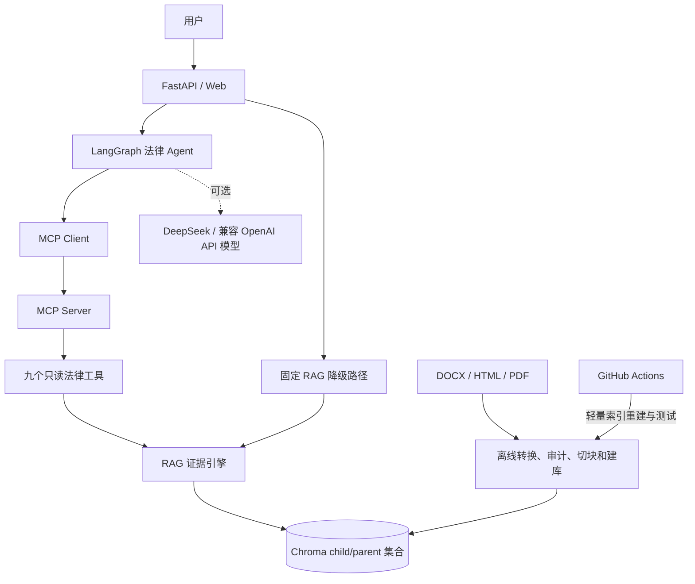
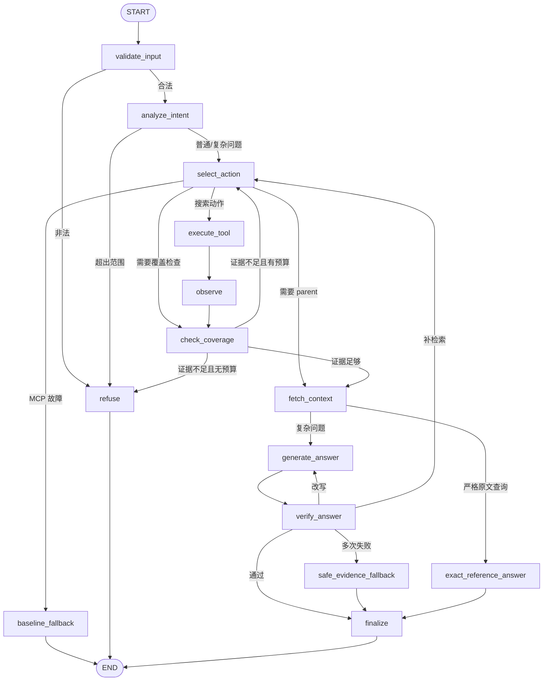

# JurisRAG：受约束法律检索 Agent 项目整体介绍

> 这是一份以 Agent 为主线的项目说明。文档先讲整体目标和系统边界，再逐层介绍状态图、工具协议、RAG 证据底座、约束验证、服务接口、评测和交付方式。
>
> 状态基准：2026-08-30，Git 提交 `9b8b1cc`。文中“当前结果”均以项目内代码、报告和自动化验证为依据；开发集指标不代表生产环境法律准确率。

## 1. 项目一句话定义

JurisRAG 是一个面向政府采购和工程招标投标法规的受约束检索 Agent。它通过 LangGraph 管理 Agent 状态，通过 MCP 调用白名单法律检索工具，以父子切块和混合检索 RAG 作为证据底座，在有限预算内完成问题理解、法律争点拆分、多轮检索、证据覆盖检查、回答验证、有限纠正和证据不足拒答。

项目的重点不是“让大模型自由回答法律问题”，而是让 Agent 在每一步都回答以下问题：

1. 用户到底在问什么？
2. 这个问题属于政府采购、工程招标，还是领域不确定？
3. 问题包含哪些需要分别验证的法律争点？
4. 当前应该调用哪一个检索工具？
5. 现有证据是否覆盖了所有争点？
6. 证据不足时应该继续查询，还是达到预算后拒答？
7. 生成的回答是否真的被返回的法条支持？

## 2. 为什么要做 Agent，而不是简单 RAG

### 2.1 普通 RAG 的处理方式

普通 RAG 通常是：

```text
用户问题 -> 一次检索 -> Top-K 文本 -> 大模型生成答案
```

这种方式适合“政府采购法第二十二条是什么”这种单一事实查询，但在法律评价问题上有明显缺陷：

- 一个问题可能同时包含多个法律争点；
- 一次召回可能只覆盖其中一个争点；
- Top-K 有结果不代表证据足够；
- 模型可能把一般规则误写成具体项目结论；
- 检索失败时没有明确的继续查询或停止机制；
- 工具故障、模型超时和重复调用没有统一控制。

### 2.2 Agent 解决什么问题

Agent 在 RAG 外面增加了一层决策控制：

```text
问题理解 -> 争点拆分 -> 工具选择 -> 观察证据 -> 判断覆盖
                                              |
                       +----------------------+----------------------+
                       |                                             |
                   证据不足                                      证据充分
                       |                                             |
                选择新工具继续检索                             回填 parent
                       |                                             |
                 达到预算仍不足                               生成并验证答案
                                                                     |
                                                          通过 / 纠正 / 拒答
```

因此，RAG 负责“提供法律证据”，Agent 负责“控制检索和回答过程”。

## 3. 业务场景和项目边界

### 3.1 目标场景

项目面向以下类型的问题：

- 某部法规某一条的原文查询；
- 采购方式、供应商资格、质疑投诉、评审和合同程序等规则查询；
- 政府采购和工程招标领域的自然语言问题；
- 同时涉及条件设置、适用范围和法律后果的多争点问题；
- 需要给出法规名称、条号、页码和来源的可核验回答。

### 3.2 典型复杂问题

例如：

> 招标文件中约定投标文件超过 150 页可以否决其投标，合法吗？

这个问题并不是简单查找“150 页”，至少包含：

1. 项目是政府采购还是工程建设招标；
2. 招标文件是否可以设置页数要求；
3. 页数要求是否属于实质性要求；
4. 违反该要求是否能直接产生否决后果；
5. 该要求是否可能构成不合理限制或差别待遇；
6. 当前知识库是否有足够法规支持具体结论。

Agent 的任务是将这些争点显式化，而不是让模型用常识一次性猜结论。

### 3.3 明确不承诺的能力

本项目不是法律意见系统，不承诺：

- 自动替代律师、行政机关或司法机关作出个案结论；
- 自动保证每一份法规当前仍然有效；
- 覆盖全国所有地方性法规、行业规则、内部制度和裁判案例；
- 仅根据一条不完整事实判断具体项目一定合法或违法；
- 提供多实例分布式高可用、生产 SLA 或自动故障转移。

涉及真实业务时，必须回到官方最新文本并由专业人员核验。

## 4. 总体架构

### 4.1 系统上下文图



### 4.2 分层架构

| 层级 | 目录或模块 | 主要职责 |
| --- | --- | --- |
| 交互层 | `web/`、`online_retrieval/api.py` | Web 页面和 HTTP API |
| Agent 层 | `agent/` | 状态图、意图识别、工具选择、预算、验证和降级 |
| 协议层 | `legal_mcp/server.py` | 注册 MCP 工具、声明工具能力和传输方式 |
| 工具业务层 | `legal_mcp/service.py` | 精确、词法、向量、HyDE、parent 和覆盖查询 |
| RAG 层 | `online_retrieval/` | 召回、RRF、Reranker、证据门和固定回答 |
| 基础设施层 | `shared/` | 配置、数据模型、Embedding、Reranker、Chroma 和 LLM |
| 离线数据层 | `offline_ingestion/` | 格式抽取、Markdown、审计、父子切块和入库 |
| 评测交付层 | `evaluation/`、`tests/`、`.github/` | 指标、回归测试、CI 和发布安全边界 |

### 4.3 组件关系

```text
FastAPI
  ├── /api/v1/questions       -> 固定 Adaptive RAG
  └── /api/v1/agent/questions -> LangGraph Agent
                                  └── MCP Client
                                      └── MCP Server
                                          └── legal_mcp.service
                                              └── online_retrieval + Chroma
```

Agent 和 MCP 是在线运行路径，离线入库是独立路径。两者通过 Chroma 的 child 和 parent 集合连接。

## 5. Agent 的核心状态设计

### 5.1 为什么要有显式状态

如果把所有信息都放在 Prompt 里，Agent 很难可靠地知道：

- 已经查过哪些工具；
- 哪些证据已经获得；
- 哪些法律争点仍然缺证据；
- 当前用了多少轮、多少次工具和多少次模型调用；
- 上一轮答案验证为什么失败。

因此，项目使用 `LegalAgentState` 保存一次请求内的完整状态。它不跨请求持久化，避免不同用户的问题和证据互相污染。

### 5.2 状态字段分组

| 状态组 | 代表字段 | 用途 |
| --- | --- | --- |
| 请求信息 | `request_id`、`original_question`、`top_k` | 请求追踪和输入上下文 |
| 语义分析 | `intent`、`domain`、`terminology_map`、`legal_issues` | 决定检索方向 |
| 预算计数 | `iteration`、`tool_call_count`、`llm_call_count`、`correction_count` | 防止无限循环 |
| 动作记录 | `planned_action`、`action_history`、`attempted_action_signatures` | 审计和重复拦截 |
| 证据状态 | `child_evidence`、`parent_evidence`、`scope_documents` | 保存当前检索结果 |
| 覆盖判断 | `evidence_issue_map`、`issue_coverage`、`missing_evidence` | 判断是否继续检索 |
| 答案状态 | `draft_answer`、`citations`、`validation_result` | 生成和验证 |
| 运行结果 | `route`、`stop_reason`、`warnings`、`public_trace` | 最终响应和可观测性 |

### 5.3 Agent 状态图



## 6. Agent 各节点的详细职责

### 6.1 输入校验：`validate_input`

输入校验在所有模型和工具调用之前执行：

- 去除首尾空白；
- 拒绝空问题；
- 问题长度上限为 2,000 字；
- 为请求统一分配 `request_id`；
- 初始化完整状态，避免节点运行时出现缺失字段。

输入不合法时不调用模型、不调用 MCP，直接返回稳定的拒答响应。

### 6.2 意图和领域识别：`analyze_intent`

这一节点输出结构化的 `IntentAnalysis`，主要识别：

- 问题意图：原文查询、规则解释、合法性评价、程序咨询等；
- 所属领域：政府采购、工程招标、复合领域或不确定；
- 用户术语和法规术语的映射；
- 需要分别解决的法律争点；
- 判断结论需要哪些事实；
- 当前问题能否直接回答。

确定性规则会优先保留用户明确给出的法规名、条号和文号，防止模型把正式引用改掉。没有领域信号时，Agent 必须保留“不确定”，不能强行判断为政府采购或工程招标。

### 6.3 精确原文快速路径

对于以下问题：

> 《中华人民共和国政府采购法》第二十二条规定了什么？

如果满足以下条件，进入快速路径：

- 只有一部明确法规；
- 有明确条号或文号；
- 不包含“合法吗、能否、责任、后果、救济”等评价表达；
- 精确工具再次命中法规名和条号。

快速路径只执行：

```text
精确 MCP 查询 -> parent 回填 -> 确定性引用构造 -> 返回
```

默认不调用最终回答 LLM，降低延迟和改写风险。复杂合法性问题不能使用此路径。

### 6.4 动作选择：`select_action`

动作选择有两种来源：

1. LLM 输出结构化 `ToolAction`；
2. LLM 不可用或输出非法时，使用确定性候选策略。

模型每次只能选择一个搜索动作，`check_issue_coverage` 和 `fetch_parent_context` 由状态图固定调用，避免模型绕过系统控制。

确定性策略通常按以下顺序考虑：

1. 用户明确给出的法规、条号和文号 -> `exact_legal_search`；
2. 多争点或合法性评价 -> `multi_query_search`；
3. 自然语言问题 -> `semantic_search`；
4. 准确术语、数字和否决表达 -> `keyword_search`；
5. 其他召回不足 -> `hyde_search`；
6. 已知法规但需要范围信息 -> `lookup_document_scope`。

### 6.5 工具执行：`execute_tool`

执行前会经过确定性策略验证：

- 工具名称必须在白名单中；
- 参数必须符合对应 Pydantic Schema；
- `top_k` 被限制在允许范围；
- 多查询最多 5 条；
- 精确检索必须至少有一个正式引用信号；
- 规范化参数后计算动作 SHA-256 签名；
- 已执行过的相同工具和参数不能重复调用。

执行结果不会直接进入最终回答，而是先进入观察和证据合并节点。

### 6.6 观察和去重：`observe`

观察节点负责：

- 读取 MCP structuredContent；
- 区分 child 证据、parent 证据和范围元数据；
- 按 evidence ID 去重；
- 建立 child 与 parent 的关系；
- 记录本轮新增证据数量；
- 更新工具动作历史和公开轨迹；
- 判断是否出现连续无进展。

如果连续两轮没有新增证据，Agent 会停止继续搜索，防止“看起来在思考、实际不断重复”的循环。

### 6.7 争点覆盖检查：`check_coverage`

覆盖检查不是简单统计“返回了几个 chunk”，而是检查：

- 当前问题识别出了哪些法律争点；
- 每个争点是否有对应 evidence ID；
- 证据是否来自合理的法规范围；
- 是否还缺少条件、例外或法律后果；
- 当前是否可以直接回答、条件式回答或必须拒答。

例如，只找到“招标文件可以设置要求”的证据，并不能自动证明“违反页数要求即可否决投标”。这两个争点必须分别检查。

### 6.8 上下文回填：`fetch_context`

检索节点主要返回 child。覆盖检查通过后，系统根据 child 中的 `parent_id` 回填完整 parent：

```text
child：帮助定位
parent：提供完整法条、条件、例外和上下文
```

回填后的 parent 仍保留命中的 child ID，最终引用可以同时展示“哪一小段命中”和“完整法条是什么”。

### 6.9 回答生成：`generate_answer`

回答模型只能看到通过证据门的 parent 和必要的 child 信息，Prompt 明确要求：

- 只能依据给定证据；
- 区分政府采购与工程招标；
- 不把写入招标文件自动等同于合法；
- 不把没有数字规定自动等同于合法或违法；
- 分别回答“条件能否设置”和“违反后能否否决”；
- 证据只支持前者时，必须说明后者无法从当前证据确定；
- citation ID 只能使用系统提供的证据 ID。

如果 LLM 未配置或调用失败，系统退化为带引用的原文证据式回答，而不是编造一个模型结论。

### 6.10 答案验证：`verify_answer`

验证分为两层：

#### 确定性检查

- 回答中新出现的法规名是否存在于证据；
- 条号和文号是否有证据支持；
- 数字、期限和比例是否来自证据；
- citation ID 是否属于当前证据；
- 是否存在重复或无效引用；
- 是否有证据外的法律结论。

#### 可选 LLM 蕴含检查

- 回答是否被证据支持；
- 是否混淆政府采购和工程招标；
- 是否遗漏已经识别的法律争点；
- 是否把条件式规则夸大成绝对结论；
- 应该改写、补检索、条件式回答还是拒答。

验证失败后最多进行两次纠正。连续失败时，系统撤销模型归纳，只保留带引用的原文证据。

## 7. MCP 工具层设计

### 7.1 MCP 的作用

MCP 解决的是 Agent 和工具之间的协议问题：

```text
Agent 决策层 -> MCP Client -> MCP Server -> 检索业务函数
```

Agent 不直接导入 Chroma，也不直接调用 `legal_mcp.service`，而是通过正式 MCP Client 调用结构化工具。

### 7.2 九个工具

| 工具 | 主要用途 | Agent 何时使用 |
| --- | --- | --- |
| `exact_legal_search` | 按法规名、条号、文号精确查询 | 用户给出正式引用 |
| `keyword_search` | 术语、数字、期限和否决表达查询 | 需要精确词项 |
| `semantic_search` | 中文自然语言语义查询 | 用户使用口语或同义表达 |
| `hyde_search` | 用中性假设答案辅助语义召回 | 普通表达与法规表达差异大 |
| `multi_query_search` | 多个法律争点同时检索 | 复杂或多争点问题 |
| `fetch_parent_context` | 根据 parent ID 取完整法条 | 检索后固定回填 |
| `lookup_document_scope` | 查询类别、状态和官方来源 | 需要适用范围辅助信息 |
| `get_source_metadata` | 查询页码、文件、URL 和哈希 | 构造溯源引用 |
| `check_issue_coverage` | 检查争点是否覆盖 | 决定继续、回答或拒答 |

### 7.3 工具安全属性

所有工具声明：

- `readOnlyHint=true`；
- `destructiveHint=false`；
- `idempotentHint=true`；
- `openWorldHint=false`。

这表示 MCP 层只查询当前法律知识库，不修改文件、不写入数据库、不访问未声明的外部业务系统。

### 7.4 两种传输方式

- `stdio`：适合本机 Agent 以子进程运行，不需要开放额外端口；
- Streamable HTTP：适合 API 和独立调试，默认地址为 `http://127.0.0.1:8001/mcp`。

## 8. RAG 证据底座

Agent 的决策质量依赖底层证据质量，因此 RAG 仍然是项目的重要基础，但它不再是项目叙事的唯一重点。

### 8.1 离线数据流程

```text
DOCX / HTML / PDF
       ↓
文本抽取和网页清洗
       ↓
结构化 Markdown
       ↓
法规/章节/条号/页码解析
       ↓
SHA-256 和 Markdown 审计
       ↓
parent / child 切块
       ↓
中文 Embedding
       ↓
Chroma child + parent 集合
```

### 8.2 当前语料规模

| 项目 | 数量 |
| --- | ---: |
| 主清单法规 | 20 |
| 去重后法规文档 | 66 |
| 跳过的重复文档 | 14 |
| parent | 1,565 |
| child | 2,299 |

66 份是当前项目收集并通过审计的唯一文档数量，不代表全国政府采购和招投标法律体系完整。

### 8.3 父子切块

- parent：完整法条或普通章节；
- child：对超长 parent 进一步切分，默认最大 500 字、80 字重叠；
- child 用来检索；
- parent 用来回答和引用；
- 多个 child 通过稳定的 parent ID 归属于同一法条。

这解决了两个冲突：检索需要短文本，法律回答需要完整上下文。

### 8.4 Chunk 溯源元数据

每个 chunk 保存：

- 法规名、文号、类别；
- 章节、条号、结构类型；
- `page_number`、`page_start`、`page_end`；
- 原文件名、Markdown 文件名；
- 来源 URL、附件 URL、验证 URL；
- 原文件 SHA-256；
- `parent_id`、`child_id`、`child_index`；
- `source_format`。

所以最终引用可以回到：

```text
法规 -> 具体条号 -> PDF 页码/Markdown -> 原始文件 -> 官方来源
```

### 8.5 混合召回

固定 RAG 和 MCP 工具底层采用：

1. 法规名、条号和文号精确匹配；
2. BM25 词法检索；
3. BGE-small-zh-v1.5 中文向量检索；
4. RRF 排名融合；
5. BGE Reranker 对前 20 个候选重排；
6. parent 回填。

初始候选数量约为：

```text
candidate_k = min(corpus_size, max(top_k × 8, 20))
```

RRF 使用：

```text
RRF_score(d) = Σ 1 / (RRF_K + rank(d))
```

默认 `RRF_K=60`。

### 8.6 多路补召回

证据不足时，系统可以构造三种检索变体：

- 问题式：拆分法律争点；
- 答案式：生成中性 HyDE 假设答案；
- 关键词式：提取主体、行为、数字和法律后果。

这些文本只用于检索，尤其是 HyDE 假设答案不能作为法律证据，也不能直接进入最终引用。

## 9. 约束、预算和失败处理

### 9.1 Agent 预算

默认配置：

| 预算 | 默认值 | 作用 |
| --- | ---: | --- |
| 最大检索轮数 | 3 | 限制多轮搜索深度 |
| 最大 MCP 调用 | 8 | 限制工具调用成本 |
| 最大 LLM 调用 | 7 | 限制外部模型成本 |
| 最大纠正次数 | 2 | 防止答案纠正死循环 |
| 最大 child 证据 | 20 | 限制状态体积 |
| 最大 parent 证据 | 8 | 限制生成上下文 |
| 最大引用数 | 5 | 限制出站内容 |
| 无进展轮数 | 2 | 防止重复搜索 |
| Agent 图超时 | 90 秒 | 限制状态图运行时间 |
| 端到端请求超时 | 120 秒 | 限制整个 API 请求 |

### 9.2 网络和服务预算

- 单次 LLM 调用超时 35 秒；
- 单次 MCP 会话超时 30 秒；
- MCP 连接最多尝试 2 次；
- 连续 3 次连接失败后熔断 30 秒；
- 单进程同时最多运行 2 个 Agent 请求；
- MCP 失败时可降级为固定 RAG；
- 模型回答不稳定时可回退为原文证据式回答。

### 9.3 何时拒答

系统在以下情况拒答：

- 问题为空或超过长度限制；
- 问题超出政府采购和招标投标知识库范围；
- 多轮检索后关键争点仍无证据；
- 达到工具、轮次或时间预算；
- 回答引用不合法；
- 模型连续生成不受证据支持的结论；
- 最终响应不符合出站契约。

拒答是明确的业务结果，返回原因和需要补充的事实，而不是抛出内部异常或伪造引用。

## 10. 输出契约和可追溯回答

### 10.1 Agent 响应字段

最终响应包含：

- `answer`：回答或拒答文本；
- `answerability`：`direct`、`conditional` 或 `insufficient`；
- `citations`：法规名、条号、页码、原文、来源和 evidence ID；
- `source_titles`：涉及的法规；
- `legal_issues`：识别出的法律争点；
- `missing_user_facts`：还需补充的事实；
- `generation_mode`：LLM、原文回退或拒答；
- `stop_reason`：停止原因；
- `agent_trace`：公开的节点、工具、预算和验证摘要。

### 10.2 引用约束

直接或条件式回答必须：

- 至少有一条引用；
- 引用 ID 来自当前证据；
- 法规名和原文不能为空；
- 引用不能重复；
- 引用数不能超过 5。

证据不足拒答必须：

- `answerability=insufficient`；
- `insufficient_evidence=true`；
- 不携带看似支持结论的引用。

### 10.3 不暴露隐藏思维链

Web 页面和 API 只返回公开决策摘要，例如：

- 调用了哪些工具；
- 召回了多少候选；
- 是否继续检索；
- 证据是否充分；
- 最终为何回答或拒答。

不返回模型的隐藏思维链、完整 Prompt 或内部推理过程。

## 11. 接口与运行方式

### 11.1 服务入口

```powershell
# 终端一：启动 MCP Server
.venv\Scripts\python.exe run_mcp.py --transport streamable-http --port 8001

# 终端二：启动 FastAPI 和 Web
.venv\Scripts\python.exe run_api.py
```

### 11.2 主要接口

| 接口 | 作用 |
| --- | --- |
| `/` | Web 问答页面 |
| `/docs` | FastAPI OpenAPI 页面 |
| `/live` | 进程存活检查 |
| `/health` | 索引和模型健康检查 |
| `/ready` | 固定 RAG 和 Agent 就绪检查 |
| `/api/v1/questions` | 固定 RAG 问答 |
| `/api/v1/agent/health` | Agent/MCP 工具健康检查 |
| `/api/v1/agent/questions` | Agent 问答 |

### 11.3 两条问答路径

```text
固定 RAG：问题 -> hybrid_search -> answer_question

Agent RAG：问题 -> LangGraph -> MCP 工具 -> 证据门 -> 回答验证
                                             \-> 固定 RAG 降级
```

固定 RAG 保留的原因是：

- 作为 Agent 的质量基线；
- Agent 依赖异常时可以继续服务；
- 便于做 Agent 与固定 RAG 的 A/B 对比；
- 离线关闭 LLM 时仍然可以完成证据式回答。

## 12. 评测方法和当前结果

### 12.1 为什么要分层评测

Agent 项目不能只用一个“准确率”描述，因此按以下层级评测：

| 层级 | 指标 | 关注点 |
| --- | --- | --- |
| 数据质量 | Markdown 审计、SHA-256 | 原文是否可追溯 |
| 检索质量 | Recall@K、MRR | 正确 parent 是否进入前 K |
| Agent 行为 | 工具、轮数、覆盖、停止 | Agent 是否按策略运行 |
| 安全性 | 拒答和错误拒答 | 证据不足是否停止 |
| 生成质量 | RAGAS | 答案是否基于上下文 |
| 工程质量 | Pytest、CI | 修改后能否回归 |

### 12.2 底层 RAG 结果

50 道有答案开发集、Top-K=5：

| 指标 | 结果 |
| --- | ---: |
| Parent Recall@1 | 0.6200 |
| Parent Recall@3 | 0.8500 |
| Parent Recall@5 | 0.9500 |
| MRR@5 | 0.7530 |
| 文档命中率@5 | 0.9800 |
| 法条命中率@5 | 0.9600 |
| 有答案题错误拒答 | 0/50 |
| 无答案题正确拒答 | 10/10 |

这些结果说明底层检索在当前开发集上可以较好地把目标 parent 召回，但不代表 Agent 已经获得 95% 的法律回答准确率。

### 12.3 RAG 消融结果

| 配置 | Recall@1 | Recall@5 | MRR@5 | 平均延迟 |
| --- | ---: | ---: | ---: | ---: |
| 字符哈希，无 Reranker | 0.45 | 0.84 | 0.6107 | 158.85 ms |
| BGE Embedding，无 Reranker | 0.57 | 0.90 | 0.7140 | 361.80 ms |
| BGE + Reranker | 0.62 | 0.95 | 0.7530 | 5,969.48 ms |
| 最终证据门和多路召回 | 0.62 | 0.95 | 0.7530 | 8,429.10 ms |

结论：

- 中文 Embedding 主要改善自然语言语义召回；
- Reranker 主要改善头部排序和 Top-K 命中；
- 证据门和多路召回主要改善安全控制，不应直接宣称提升了这 50 道题的 Recall；
- CPU Reranker 是主要延迟瓶颈。

### 12.4 Agent 评测边界

当前已经有 Agent 工程冒烟测试，用于验证：

- 意图和领域字段；
- 首个工具选择；
- 预算终止；
- 重复调用拦截；
- 引用合法性；
- 禁止性表述和拒答路径。

但固定 RAG 与 Agent 的完整冻结 A/B 还没有形成可声明的质量提升结果。因此当前适合说：

> Agent 闭环和约束机制已经实现并通过工程测试，底层 RAG 有独立召回指标；Agent 对法律回答质量的独立增益仍需进一步评测。

### 12.5 RAGAS 当前状态

RAGAS 评测部分完成：

- 50/50 题完成答案生成；
- 42/50 题完成全部五项评分；
- 评测模型账户余额不足导致部分题目失败；
- 失败题未按 0 分纳入均值。

成功样本均值：

| 指标 | 均值 | 成功题数 |
| --- | ---: | ---: |
| Context Precision | 0.9112 | 43 |
| Context Recall | 0.9545 | 44 |
| Faithfulness | 0.9756 | 43 |
| Answer Relevancy | 0.9330 | 43 |
| Factual Correctness | 0.2638 | 42 |

Factual Correctness 偏低还受到参考答案粒度影响：人工参考答案平均约 34 字，生成答案平均约 399 字。正确做法是人工扩写并冻结 gold 后重新评测，而不是删减正确答案迎合分数。

## 13. 项目当前完成情况

### 13.1 已完成并验证

- LangGraph Agent 状态图和有限循环；
- 意图、领域、术语和法律争点识别；
- MCP Client/Server 和九个只读工具；
- 工具白名单、参数 Schema 和重复动作拦截；
- 多轮检索、证据合并、覆盖检查和 parent 回填；
- 证据门、回答验证、有限纠正和安全拒答；
- 固定 RAG 降级路径；
- LLM 节点级 Token、耗时和成功状态观测；
- FastAPI、Web、健康检查和公开 Agent trace；
- 44 项自动化测试；
- GitHub Actions 干净 checkout、索引构建和测试回归。

### 13.2 已实现但验证仍不完整

- Agent 与固定 RAG 的完整质量 A/B；
- RAGAS 五项指标的完整 50 题结果；
- Docker 容器端到端启动和压力测试；
- 法规修订、废止和地方规则的持续自动同步；
- 多实例部署下的全局限流和共享熔断。

## 14. 代码目录和阅读顺序

### 14.1 目录

```text
JurisRAG/
├─ agent/                     # Agent 状态图、策略、状态、服务和模型调用
├─ legal_mcp/                 # MCP 注册层和法律检索工具业务层
├─ online_retrieval/          # 固定 RAG、检索、回答和 FastAPI
├─ offline_ingestion/         # 文件抽取、Markdown、审计、切块和建库
├─ shared/                    # 配置、数据模型、Chroma、Embedding、Reranker、LLM
├─ data/source/               # 原始法规、manifest 和哈希
├─ data/processed/            # 结构化 Markdown 和审计报告
├─ evaluation/                # gold 数据、评测脚本和结果报告
├─ tests/                     # Agent、MCP、RAG、Web 和可靠性测试
├─ web/                       # Web 前端
├─ docs/                      # 项目设计、优化记录和面试材料
├─ run_api.py                 # API 启动入口
├─ run_mcp.py                 # MCP 启动入口
└─ compose.yaml               # API/MCP 容器编排
```

### 14.2 推荐阅读顺序

1. `README.md`：安装、启动和接口；
2. `agent/state.py`：理解一次请求保存什么状态；
3. `agent/graph.py`：理解 Agent 节点和路由；
4. `agent/actions.py`、`agent/policy.py`：理解工具选择和约束；
5. `legal_mcp/server.py`：理解工具怎样注册；
6. `legal_mcp/service.py`：理解工具背后的检索逻辑；
7. `online_retrieval/retriever.py`：理解混合召回和证据门；
8. `online_retrieval/answerer.py`：理解生成、验证和固定回答；
9. `agent/service.py`：理解超时、降级、并发和最终契约；
10. `evaluation/`、`tests/`：理解指标和行为边界。

## 15. 一个完整请求的执行示例

问题：

> 招标文件中约定投标文件超过 150 页可以否决其投标，合法吗？

### 第一步：输入校验

API 接收问题，校验长度并生成 request ID。

### 第二步：意图分析

Agent 判断这是一个法律评价问题，而不是单纯原文查询，因此不能进入精确快速路径。

### 第三步：争点拆分

输出可能类似：

```text
领域：uncertain / 可能涉及政府采购或工程招标
争点：
1. 招标文件能否设置页数要求
2. 页数要求是否属于实质性要求
3. 违反页数要求能否否决投标
4. 是否可能构成限制竞争
```

### 第四步：选择首个工具

由于是多争点法律评价问题，优先选择多查询、语义或关键词工具，而不是只查询“150 页”。

### 第五步：观察证据

Agent 合并 child 结果，并为每条证据记录来源、条号、页码和 parent ID。

### 第六步：检查覆盖

如果只覆盖了“招标文件可以设置要求”，但没有覆盖“违反后能否否决”，Agent 会把第二个争点标记为缺失。

### 第七步：补召回

Agent 选择未使用的工具，执行问题式、关键词式或 HyDE 检索。假设答案只用于帮助查找，不进入证据引用。

### 第八步：回填 parent

对命中的 child 按 parent ID 回填完整法条或章节，保留多个 child 的命中关系。

### 第九步：生成条件式回答

如果证据支持条件设置但不支持直接否决，回答必须明确拆开：

```text
条件能否设置：当前证据支持到什么程度
违反后的否决后果：当前证据是否足够
仍需事实：项目类型、完整招标文件、条款位置和评审规则
```

### 第十步：验证和结束

系统检查法规名、条号、数字和引用。如果验证失败，最多纠正两次；仍不通过则保留原文证据或拒答。

## 16. 设计取舍

### 16.1 为什么 Agent 不直接访问 Chroma

直接访问会让 Agent 绕过工具权限、参数校验和统一响应契约。通过 MCP，Agent 只能使用声明过的能力，检索服务也可以独立测试和部署。

### 16.2 为什么不让 Agent 无限循环

无限循环会导致：

- 工具和模型成本不可控；
- 反复查询相同内容；
- 请求延迟无法预测；
- 错误状态不断积累。

因此采用显式预算和无进展停止。

### 16.3 为什么保留固定 RAG

固定 RAG 是：

- Agent 的底层证据实现；
- Agent 失败时的降级路径；
- A/B 评测的基线；
- 无 LLM 环境下的可运行模式。

### 16.4 为什么不把 LLM 当作法律知识来源

模型可以帮助识别意图、拆分争点、规划检索和组织语言，但不能替代当前法规证据。任何最终结论都必须建立在返回的 parent 法条和可追溯引用上。

## 17. 后续优化方向

### P0：补齐 Agent 评测

1. 建立固定 RAG 与 Agent 的同题 A/B；
2. 增加意图识别、领域路由和争点覆盖标注；
3. 统计首个工具选择正确率；
4. 统计工具调用次数和重复动作比例；
5. 统计证据外结论率、拒答精确率和误拒答率；
6. 统计 Agent P50/P95 延迟和纠正成功率。

### P0：降低 Reranker 延迟

1. 对 `RERANK_CANDIDATES=10/15/20` 做质量和性能消融；
2. 精确条号问题跳过不必要的 Reranker；
3. 测试更小的中文 Reranker；
4. 使用 INT8、批量推理或 GPU；
5. 对稳定查询和候选结果做版本化缓存。

### P1：加强法规时效

1. 维护修订、废止、替代和生效关系；
2. 对来源变化进行定期检查；
3. 对状态不明法规展示醒目提示；
4. 增加法规版本切分评测。

### P1：完成服务化验收

1. 完成 Docker API/MCP 端到端启动；
2. 增加结构化日志、指标和告警；
3. 做 Agent 并发和长问题压测；
4. 多副本部署时再增加网关限流和共享状态。

## 18. 面试介绍模板

### 18.1 30 秒版本

> 我做的是一个面向政府招标采购法规的受约束检索 Agent。Agent 通过 LangGraph 管理意图识别、争点拆分、工具调用、证据覆盖和回答验证，通过 MCP 调用精确、关键词、语义和多查询检索工具；底层使用父子切块和混合 RAG 提供可追溯法条。如果证据不足，Agent 会继续检索，超过预算仍不足就拒答，而不是让模型直接猜结论。

### 18.2 2 分钟版本

> 项目最初是固定字符切块加单路向量检索，存在法条边界丢失、编号检索不准和证据不足仍然回答的问题。我把它升级成以 Agent 为中心的受约束检索系统。首先将 DOCX、HTML、PDF 转成带章节、条号、页码和 SHA-256 的结构化 Markdown，再用法条 parent 和 500 字 child 建立可溯源知识库。然后将精确匹配、BM25、BGE 向量、RRF 和 Reranker 封装成 MCP 工具。Agent 会先识别问题意图、领域和法律争点，再选择工具；观察返回证据后检查每个争点是否覆盖，不足时切换问题式、关键词式或 HyDE 继续查询。证据足够才回填完整 parent 并生成答案，生成后还要检查法规名、条号、数字、引用和证据蕴含，验证失败则有限纠正或拒答。为了防止循环，我设置了三轮检索、八次工具调用、七次模型调用和两次纠正，并增加了 MCP 重试、熔断、超时和固定 RAG 降级。底层 RAG 在 50 道开发集上的 Parent Recall@5 是 0.95，MRR@5 是 0.753，44 项自动化测试通过。这个指标说明底层检索效果，不等于生产法律回答准确率；Agent 的完整 A/B 质量评测和容器端到端验收仍是后续工作。

## 19. 项目结论

JurisRAG 当前最重要的能力不是“用了多少个 LLM 组件”，而是完成了一个可解释的 Agent 闭环：

```text
理解问题 -> 选择工具 -> 获取证据 -> 检查覆盖 -> 继续或停止
                                       ↓
                              生成 -> 验证 -> 纠正/拒答
```

项目的核心展示点可以归纳为五个：

1. LangGraph 状态图和 Agent 工作流编排；
2. MCP 结构化工具和 Tool Calling 约束；
3. RAG 多路检索作为 Agent 的证据工具；
4. 证据门、回答验证和安全拒答；
5. 预算、超时、熔断、降级、评测和可观测性。

这五项能力足以支撑实习面试中的深入讨论，也比简单罗列所有依赖库更能体现你对 Agent 系统设计的理解。
