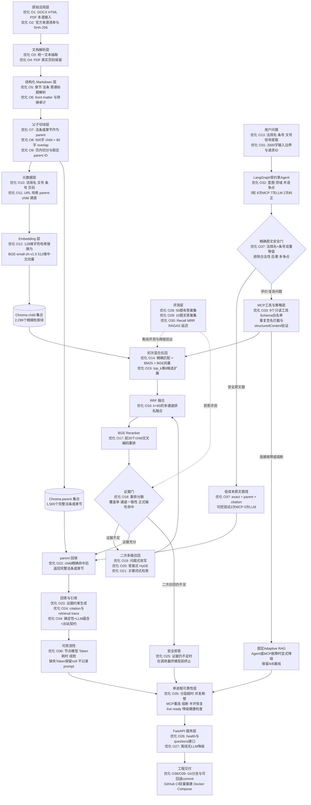

# JurisRAG 简历项目描述（STAR 法则）

> 历史文档：以下描述对应重构前实现，不可直接当作当前轻量版功能或指标。当前可核验架构见 README 与 docs/Agent项目整体介绍.md，指标只引用本版本实际报告。

> 使用说明：本文第一部分可直接精简后放入简历，第二部分用于面试时按 STAR 法则展开。所有指标均来自项目内开发集评测，不代表生产环境法律准确率。

## 一、简历可直接使用的版本

### 项目名称

**JurisRAG：面向政府招标采购法规的受约束检索 Agent**

### 技术栈

Python、LangGraph、MCP、FastAPI、Chroma、BM25/BGE RAG、Pytest

### 项目描述

面向政府采购与工程招投标法规构建受约束检索 Agent：以父子切块和混合 RAG 作为证据工具，通过 MCP 暴露九个结构化只读工具；外层 LangGraph Agent 根据意图、领域和法律争点动态选择工具，执行多轮检索、证据覆盖检查、引用验证、有限纠错和证据不足拒答。

### 项目职责与成果

- 基于 LangGraph 设计输入校验、意图/领域/术语/争点识别、动作选择、工具执行、证据观察、覆盖检查、回答生成和验证等状态节点；通过条件路由实现继续检索、生成、纠正、拒答和固定 RAG 降级。
- 使用 MCP 将精确法规查询、BM25 关键词检索、中文语义检索、HyDE、多查询、parent 回填、来源元数据和争点覆盖封装为九个结构化只读工具；通过白名单、参数 Schema、structuredContent 和动作 SHA-256 签名拦截非法或重复调用。
- 针对复杂法律问题设计问题式、关键词式和答案式补召回，Agent 根据争点覆盖和证据缺口动态决定是否继续检索；达到三轮、八次工具调用或时间预算后仍缺证据则拒答，不让模型脱离法规猜测。
- 增加回答中的法规名、条号、数字、引用 ID 和证据蕴含校验，验证失败后最多进行两次改写或补检索，仍失败则撤销模型结论并回退到原文证据；Agent 已完成真实单题闭环，但尚未完成冻结 A/B，因此不声明 Agent 带来量化准确率提升。
- 以父子切块和“精确匹配 + BM25 + BGE 向量 + RRF + Reranker”构建 Agent 的法律证据工具；在同一 50 题开发集上 Parent Recall@5 从 0.84 提升至 0.95，MRR@5 从 0.6107 提升至 0.7530，最终形成 66 份文档、1,565 个 parent 和 2,299 个 child。
- 增加分层超时、MCP 有限重连与连续失败熔断、进程内并发舱壁、固定 RAG 降级、节点级 Token/耗时观测、FastAPI/Web 健康检查和请求 ID 追踪；完成 44 项自动化测试和 GitHub Actions 干净环境回归。该实现属于单进程可靠性保护，未做并发压测，不写 QPS 或 99.9% 可用性。

## 二、STAR 法则详细讲述

### S：Situation，项目背景

政府采购和招标投标领域的资料同时存在 DOCX、HTML、PDF 等格式，法规名称、文号、章节、条号和页码结构不一致。普通 RAG 直接把全文按固定字符切分，容易产生以下问题：

1. 法条边界被截断，命中的是一句话，但回答缺少完整法条上下文。
2. “政府采购法第二十二条”“财政部令第87号”等准确编号没有被特殊处理。
3. 128 维字符哈希只能反映字面重合，难以处理自然语言改写和同义表达。
4. 向量 Top-K 直接作为证据，相关性不足时仍可能被大模型包装成确定结论。
5. 结果缺少条号、页码、来源 URL 和文件哈希，无法核验引用来自哪份原文。

项目最初是一个 10 份法规、固定 500 字切块、80 字重叠、字符哈希向量加 Chroma Top-K 的基线。该版本在 10 题开发集上的 Recall@5 为 0.50，说明“能运行”但还不足以支持法规问答。

### T：Task，项目目标

我的任务不是只接入一个大模型 API，而是把基线升级为一个可以在面试中完整解释、可以复现实验、可以追溯证据的法律检索 Agent：

- 建立多格式法规处理与数据质量审计流程；
- 保留法律文档的章节、条号和 PDF 页码；
- 同时解决准确编号检索与自然语言语义检索；
- 命中细粒度法条后召回完整上级内容；
- 对证据不足的问题拒答，不让模型脱离语料猜测；
- 用固定评测集和消融实验验证每项主要优化。

### A：Action，采取的措施

#### 1. 数据治理和结构化

- 收集并保留 DOCX、HTML、PDF 原文件，将主清单与补充法律汇集合并后按 `document_id` 和 SHA-256 去重。
- 为原文件建立 manifest、来源 URL、法规类别、文号、发布日期、施行日期和 SHA-256 元数据。
- 将原文转换为结构化 Markdown：一级标题保存法规名，二级标题保存章节，三级标题保存法条；PDF 通过 `<!-- page: N -->` 保留真实页码。
- 在入库前校验原文哈希、Markdown front matter、Markdown 哈希、审计报告和文件路径，任一不一致就停止入库。

#### 2. 父子切块和精确溯源

- 先按 Markdown 结构识别法条、普通章节和前言，每条法条或章节作为 parent。
- parent 超过长度限制时，按段落和页码生成不超过 500 字、重叠 80 字的 child，避免跨页伪造精确页码。
- child 参与检索，命中后按稳定 parent ID 回填完整法条；响应同时返回命中 child 和完整 parent。
- 每个节点保存法规标题、文号、章节、条号、页码起止、Markdown 文件、原文件、来源网址、SHA-256、parent ID 和 child ID。

#### 3. 混合召回与排序

- 从问题中识别法规名、中文或阿拉伯数字条号、文号和准确短语，为正式法律编号增加确定性匹配分。
- 使用 BM25 处理准确术语，使用 BGE-small-zh-v1.5 处理自然语言和同义表达。
- 每路召回约 `top_k × 8` 个候选，至少 20 个，通过 `1 / (60 + rank)` 的 RRF 进行无量纲融合。
- 对融合后的前 20 个 child 使用 bge-reranker-base ONNX 交叉编码器重排，再按 parent ID 去重并回填完整内容。

#### 4. 多路补召回和安全拒答

- 初次证据不足时生成三类检索表达：问题式改写、答案式 HyDE、关键词式提炼。
- 问题式同时走 BM25 和向量通道，答案式走向量通道，关键词式走 BM25 通道，之后重新执行 RRF 和 Reranker。
- 证据门综合判断 Reranker 分数、问题词加权覆盖率、多通道一致性及法规名和条号是否在同一候选中准确命中。
- 二次召回后仍不满足阈值时，在最终生成模型调用之前拒答，避免把低质量候选伪装成正式引用。

#### 5. 评测与工程化

- 从 10 道单法条问题扩充到 50 道有答案题，增加自然语言改写、场景题、数值题、多证据题和法律后果题。
- 单独建立 10 道无答案集，覆盖不存在的条号、域外规则、地方未来政策、知识库外事实和案件结果预测。
- 记录 Recall@1/3/5、MRR@5、文档命中率、法条命中率、RAGAS Context 指标、拒答结果、平均/P50/P95 延迟和冷启动时间。
- 通过 FastAPI 暴露 `/health` 和 `/api/v1/questions`，响应包含 citations、source_count、generation_mode、refusal_reason 和 retrieval_trace。

### R：Result，实际结果

#### 最终系统规模

| 项目 | 结果 |
| --- | ---: |
| 去重后法规文档 | 66 份 |
| parent 法条/章节 | 1,565 个 |
| child 检索块 | 2,299 个 |
| 结构化法律汇集转换 | 60/60 成功，审计警告 0 |
| 50 道有答案开发集 | Recall@1 0.62，Recall@3 0.85，Recall@5 0.95，MRR@5 0.753 |
| 有答案错误拒答 | 0/50 |
| 10 道无答案开发集 | 正确拒答 10/10，不安全回答 0 |
| 自动化测试 | 44 passed |
| Agent 精确法条在线闭环 | 1轮、3次MCP、4次可计数模型调用、55.87秒 |
| Agent 复杂合法性问题回归 | “150页否决”2轮、`agent_llm`、2个parent引用、81.24秒；仅作条件式回答 |

#### 同一 50 题开发集上的消融结果

| 配置 | Recall@1 | Recall@5 | MRR@5 | 平均检索延迟 |
| --- | ---: | ---: | ---: | ---: |
| 字符哈希，无 Reranker | 0.45 | 0.84 | 0.6107 | 158.85 ms |
| BGE 中文 Embedding，无 Reranker | 0.57 | 0.90 | 0.7140 | 361.80 ms |
| BGE 中文 Embedding + Reranker | 0.62 | 0.95 | 0.7530 | 5969.48 ms |
| 最终证据门与多路召回版本 | 0.62 | 0.95 | 0.7530 | 8429.10 ms |

结果说明：中文 Embedding 主要改善语义召回，Reranker 进一步改善头部排序和 Top-5 命中；证据门没有降低50道有答案题的放行率。当前主要工程短板是 CPU ONNX Reranker 延迟较高，后续应通过模型量化、动态批处理、缓存或候选裁剪优化，不能只展示质量指标而忽略延迟成本。

## 三、面试时需要明确的边界

- `Recall@5=0.95` 是 50 道开发集的父法条 Recall，不是“法律回答准确率95%”。
- `10/10` 是小规模无答案开发集结果，不能外推为生产环境100%安全拒答。
- 最终50道有答案题没有触发二次多路召回，因此不能声称 HyDE 提升了这组题的 Recall；它在当前版本中主要是证据不足时的补救路径。
- 最终回答可以在未配置 LLM 时退化为原文证据式回答；启用 LLM 后也只能使用证据门放行的内容。
- Agent 已完成 MCP 协议调用和状态图约束，但完整冻结 A/B 尚未运行，不能写“Agent 提升准确率”。
- 精确法条快速路径已由可控状态图测试证明减少为2次MCP、0次模型调用，但尚无真实环境延迟A/B，不能写具体加速百分比。
- 已配置 GitHub Actions 和 Docker Compose；GitHub Actions 已在提交 `fb83bfc` 上通过干净 checkout、轻量索引构建和测试，但容器尚未完成端到端启动，不能写“已上线”。
- 系统没有自动保证法规当前有效，涉及真实业务时仍需核对官方最新文本。

## 四、项目架构图（节点内标注对应优化）

