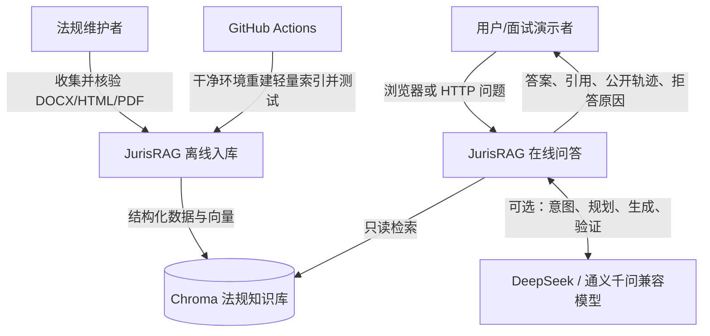
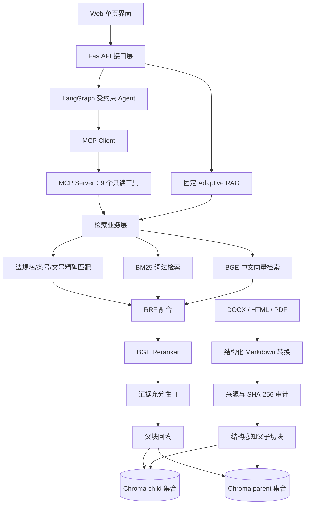
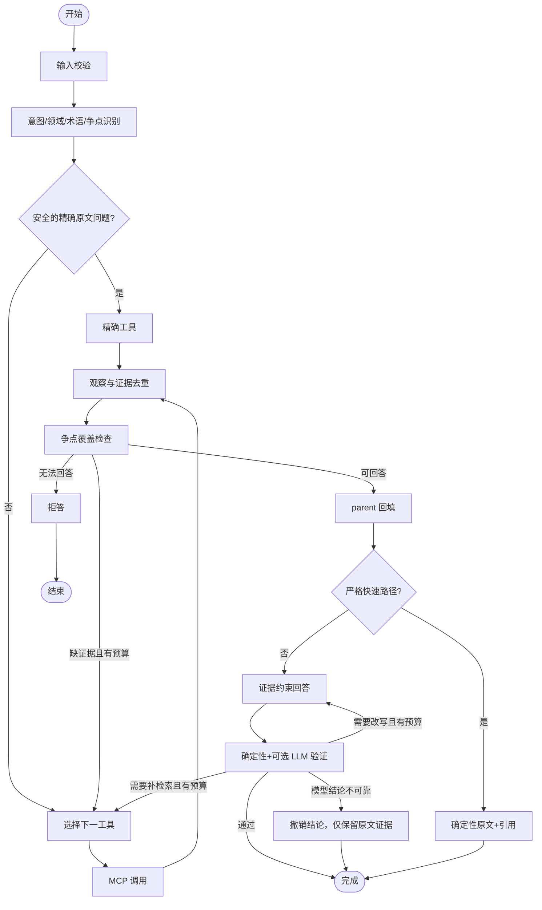

# JurisRAG 项目设计与实现说明

> 文档定位：从项目全貌逐层下钻到模块、流程、参数和代码，既可用于第一次阅读项目，也可作为面试时的系统设计讲稿。
>
> 状态基准：2026-08-29，Git 提交 `41bc362` 之后的工程状态。本文严格区分“已经实现并验证”“已实现但验证不完整”和“后续规划”。

## 1. 先用一句话理解项目

JurisRAG 是一个面向政府采购和工程招标投标法规的可溯源问答系统：它把 DOCX、HTML、PDF 法规转换成结构化 Markdown，通过父子切块建立 Chroma 知识库，在线使用精确匹配、BM25、中文向量、RRF 和 BGE Reranker 找到证据，再由受约束的 LangGraph Agent 通过 MCP 工具完成多轮检索、证据覆盖检查、回答验证和证据不足拒答。

它不是“把文档扔给大模型”的聊天程序，核心设计目标是：

1. 找得到：准确条号、专有名词和自然语言表达都能进入合适的召回通道。
2. 排得准：先扩大候选，再用融合和 Reranker 把真正相关法条向前排列。
3. 讲得清：回答附带法规名、条号、页码、原文件、官方链接和 chunk ID。
4. 不乱答：证据不够时继续检索，仍不够就拒答；模型生成内容还要接受验证。
5. 可复现：语料有 SHA-256，配置集中管理，评测有固定数据集，GitHub Actions 可以从干净 checkout 重建测试索引。

## 2. 项目要解决什么问题

### 2.1 业务问题

招标采购法规问答有几个明显难点：

- 同一个问题可能属于政府采购，也可能属于依法必须招标的工程建设项目，两套规则不能混用。
- 用户会用“甲方、废标、资质、150 页”等口语提问，而法规使用“采购人、投标无效、资格条件、实质性要求”等正式表述。
- 法规名、文号、条号、数字非常重要，只依赖语义向量容易把相似条文排在正确条文前面。
- 只返回一小段命中文本可能截断条件、例外和法律后果，造成断章取义。
- 大模型即使熟悉“甲方”一词，也不代表它已经在当前证据中找到适用规则，更不代表它可以判断具体项目是否合法。

因此，本项目把问题拆成两类能力：

- **证据检索能力**：负责从当前知识库准确找到可追溯法规。
- **受约束推理能力**：负责识别领域和争点、选择工具、检查证据覆盖、生成条件式答案并验证。

### 2.2 项目边界

当前系统适合：

- 查询某部法规某一条的原文；
- 解释政府采购、招标投标中的一般程序、条件、期限和责任规则；
- 对一个问题列出当前知识库能够支持的法规依据；
- 在事实或证据不足时说明还缺什么。

当前系统不承诺：

- 替代律师、行政机关或司法机关作出个案法律意见；
- 自动保证法规仍为最新有效版本；
- 覆盖全部地方性法规、行业规则、裁判案例和项目内部文件；
- 仅根据一句不完整描述就判断具体项目一定合法或违法；
- 提供分布式高可用、全局限流或生产级 SLA。

## 3. 自顶向下的系统全景

### 3.1 L0：系统上下文

从最外层看，系统连接四类对象：法规维护者、普通用户、模型服务和本地知识库。



最重要的边界是：LLM 不直接读取原始文件，也不直接访问 Chroma。它只能看到系统选出的结构化证据，Agent 只能调用白名单 MCP 工具。

### 3.2 L1：逻辑分层



分层后的职责是：

| 层级 | 主要目录 | 只负责什么 |
| --- | --- | --- |
| 数据源层 | `data/source/` | 保存原始法规、清单、官方来源和哈希 |
| 派生数据层 | `data/processed/` | 保存可审计的结构化 Markdown |
| 离线入库层 | `offline_ingestion/` | 转换、审计、切块、Embedding 和写库 |
| 基础能力层 | `shared/` | 配置、数据模型、Chroma、Embedding、Reranker、LLM 工厂 |
| 检索层 | `online_retrieval/` | 多路召回、融合、重排、证据门、固定 RAG 回答 |
| 工具协议层 | `legal_mcp/` | 将检索能力注册为 MCP 只读结构化工具 |
| Agent 控制层 | `agent/` | 意图识别、工具选择、循环预算、验证、纠正、降级和拒答 |
| 接口与展示层 | `online_retrieval/api.py`、`web/` | HTTP 契约、健康检查和浏览器交互 |
| 评测与交付层 | `evaluation/`、`tests/`、`.github/` | 指标、回归测试、CI 和发布安全边界 |

### 3.3 L2：两个独立运行阶段

系统不是每次提问都重新解析文档，而是把高成本的数据处理放到离线阶段。

```text
离线：原文件 -> 抽取 -> Markdown -> 审计 -> parent/child -> Embedding -> Chroma
在线：问题 -> 信号/意图 -> 多路召回 -> RRF -> Reranker -> parent -> 回答/拒答
```

这样设计的原因：

- 原文转换和向量生成耗时较高，但法规更新频率远低于用户提问频率；
- 在线只读取已经审计的结果，响应链更稳定；
- 修改语料、切块或模型后可以明确要求重建索引；
- 离线故障不会在查询时悄悄产生一半新、一半旧的数据。

## 4. 离线入库：一份法规怎样变成可检索证据

### 4.1 数据源组织

当前语料有两部分：

- `data/source/primary_laws/`：主清单法规，使用 `manifest.json` 登记。
- `data/source/legal_collection/`：后续补充的法规汇集，带转换清单和校验信息。

入库时按 `document_id` 和 SHA-256 去重。当前实际结果为：

| 指标 | 当前值 |
| --- | ---: |
| 主清单文档 | 20 |
| 补充集合最终入库文档 | 46 |
| 去重后总文档 | 66 |
| 跳过的重复文档 | 14 |
| parent | 1,565 |
| child | 2,299 |

“66 份”只表示当前项目收集并通过入库校验的唯一文档数量，不等于中国招标采购法律体系已经完整。

### 4.2 三种格式统一转 Markdown

项目当前只处理用户要求的三种格式：

- DOCX：使用 `python-docx` 读取段落和表格文本；
- HTML：使用 BeautifulSoup 去除网页结构噪声并提取正文；
- PDF：使用 `pdfplumber`/`pypdf` 按页抽取，并保留页码标记。

统一转换为 Markdown 的价值不是“换一个后缀”，而是建立一个稳定的中间表示：

- 使用标题层级保存篇、章、节和条；
- 使用 front matter 保存来源和文件元数据；
- PDF 页面边界写入 Markdown，后续 chunk 才能得到精确页码；
- HTML 导航、脚本和样式不再混入检索正文；
- DOCX、HTML、PDF 后续走同一套切块逻辑。

### 4.3 入库前审计

`offline_ingestion.build_index` 不会直接相信 Markdown。重建索引前会检查：

1. 原始文件存在且 SHA-256 与清单一致；
2. Markdown front matter 和来源路径匹配；
3. Markdown 自身哈希与转换审计报告一致；
4. 没有清单外的意外 Markdown；
5. 所有语料先验证完成，再重置旧 Chroma 集合。

最后一点用于避免一种危险状态：如果先删除旧索引，再发现第 30 份法规损坏，线上将得到不可用的半成品索引。

### 4.4 结构感知父子切块

早期固定字符切块会把一个法条切断，或者把两个法条放在同一块中。当前设计先识别法条/章节，再建立两级节点：

- **parent**：尽量保存完整法条或完整普通章节，用于最终回答和引用。
- **child**：对过长 parent 按最多 500 字、80 字重叠继续切分，用于精细检索。

一个长法条可能对应多个 child，但这些 child 共享同一个 `parent_id`。检索阶段命中 child 后，系统回填 parent，所以同时兼顾“定位精细”和“上下文完整”。

PDF 会优先按页组织 child，避免一个 child 跨越无法解释的页码边界。普通通知、附件和合同模板没有“第 X 条”时，会被标记为普通章节，而不是伪造条号。

### 4.5 每个 chunk 的元数据

每个 parent/child 不只有文本，还携带完整的溯源字段：

| 类别 | 主要字段 | 用途 |
| --- | --- | --- |
| 文档身份 | `document_id`、`title`、`category` | 确定来自哪部文件 |
| 法律状态 | `document_number`、`promulgated_date`、`effective_date`、`legal_status` | 辅助判断文件范围和时效 |
| 官方来源 | `source_portal`、`source_url`、`attachment_url`、`verification_url` | 回到官方页面核验 |
| 完整性 | `raw_file`、`sha256`、`markdown_file` | 回到确切原文件和派生 Markdown |
| 法条结构 | `chapter`、`article_number`、`section_title`、`section_path`、`structure_type` | 展示和精确匹配 |
| 父子关系 | `node_type`、`parent_article_id`、`parent_section_id`、`child_index` | child 命中后回填 parent |
| 页码 | `page_number`、`page_start`、`page_end`、`page_numbers` | PDF 引用定位 |
| 技术定位 | `chunk_id`、`chunk_index`、`source_format` | 调试、去重和追踪 |

因此，一条引用可以回答三个问题：命中了哪一小段、回答使用了哪一完整法条、原文究竟在哪里。

### 4.6 Chroma 双集合

索引包含两个集合：

- child 集合保存真实 Embedding，参与词法和向量检索；
- parent 集合只承担 `parent_id -> 完整正文` 映射，不执行向量查询，因此使用固定零向量存储。

这种设计避免把可能很长的 parent 送入有长度限制的 Embedding 模型，也避免 parent 和 child 混排。

## 5. 在线固定 RAG：一次检索具体怎样执行

固定 RAG 是系统的稳定基线，也是 Agent/MCP 故障时的降级路径。

### 5.1 第一步：解析问题信号

`_query_signals` 会提取：

- 法规名称，例如《政府采购法》；
- 条号，例如“第二十二条”“第 22 条”；
- 文号，例如“财政部令第 87 号”；
- 数字、专有词和关键实体；
- 是否属于自然语言法律评价问题。

正式引用会获得确定性加分。这样“政府采购法第二十二条”不会只依靠相似度碰运气。

### 5.2 第二步：初次多路召回

初次检索至少包含两个通道：

1. **BM25 词法通道**：适合条号、文号、金额、期限、机构名和准确术语。
2. **BGE 向量通道**：适合自然语言、同义词和口语到法言法语的语义匹配。

每个通道的候选数为：

```text
candidate_k = min(语料 child 数, max(top_k × 8, 20))
```

先取较大的候选池，是因为 Reranker 只能重排“已经被召回”的内容；正确法条没有进入候选池，精排再强也无法找回。

### 5.3 第三步：RRF 融合

不同通道的原始分数不可直接相加：BM25 分数和向量距离不是同一尺度。项目采用 Reciprocal Rank Fusion：

```text
RRF_score(d) = Σ 1 / (RRF_K + rank_channel(d))
```

默认 `RRF_K=60`。一个候选如果同时被词法和向量通道排在前面，会获得更高融合排名。

### 5.4 第四步：BGE Reranker 精排

RRF 后的前 20 个 child 送入 `bge-reranker-base` ONNX 交叉编码器。它同时阅读“问题 + 候选正文”，比单独生成向量更适合判断细粒度相关性。

所以本项目不是“Chroma 直接 Top-K 后就回答”，而是：

```text
召回候选 -> RRF 粗融合 -> Reranker 精排 -> parent 去重回填
```

Reranker 是当前检索质量的重要来源，也是当前最大的延迟来源。50 题消融中，加入 Reranker 后 Recall@5 从 0.90 提升到 0.95，但平均检索延迟从约 361.80 ms 增长到约 5,969.48 ms。

### 5.5 第五步：证据充分性门

系统不会把“Top-1 总有一个结果”理解成“证据一定够”。证据门综合判断：

- Reranker 分数；
- 问题关键项在证据中的加权覆盖率；
- 同一候选得到多少检索通道支持；
- 用户给出的法规名、条号、文号是否真正满足；
- 可选 LLM planner 对争点覆盖和可回答性的结构化判断。

默认关键阈值是：最低 Reranker 分数 3.0、最低加权覆盖 0.20、最低通道一致数 2。这些分数是当前模型和开发集下的工程阈值，不是法律可信度概率。

### 5.6 第六步：证据不足时补召回

初次证据不足，或问题明显需要补充规范性规则时，系统可以生成三种检索表达：

- 问题式：把复合问题拆成具体法律争点；
- 答案式：生成中性假设答案进行 HyDE 向量检索；
- 关键词式：提取条号、行为、主体、后果等词做 BM25。

这些变体只用于“寻找原始法规”。HyDE 的假设答案永远不能作为引用，也不能直接证明法律结论。扩展候选再次经过 RRF 和同一原问题的 Reranker，避免假设文本把检索方向带偏。

### 5.7 第七步：parent 回填与回答

最终 child 按 `parent_id` 去重并回填完整法条/章节。之后有两种输出：

- 开启 LLM：模型只能基于通过证据门的 parent 生成答案，温度为 0，并接受引用、数字和法规名检查。
- 关闭 LLM 或模型失败：返回可读的原文证据式回答，不伪装成模型归纳结论。

如果二次检索后仍不充分，系统在最终生成模型调用之前拒答，且拒答不携带看似支持结论的引用。

## 6. Agentic RAG：为什么还需要 Agent

固定 RAG 适合单次查询，但复杂法律问题往往包含多个争点。例如“超过 150 页是否可以否决投标”至少要区分：

1. 项目属于政府采购还是工程招标；
2. 招标文件能否设置格式或页数要求；
3. 该要求能否被认定为实质性要求；
4. 违反要求能否直接产生否决后果；
5. 是否构成不合理限制或差别待遇。

一次 Top-K 很可能只召回其中一部分。Agent 的价值不是“让模型自由思考”，而是按状态和预算控制多轮工具调用。

### 6.1 Agent 状态图



### 6.2 意图、领域和术语

Agent 首先使用确定性规则保留用户显式给出的法规名、条号和文号，再按需让 LLM 输出结构化 Schema：

- `intent`：查原文、解释规则、判断合规、询问程序等；
- `domain`：政府采购、工程招标、两者都有或不确定；
- `terminology_map`：例如“甲方 -> 采购人/招标人（待领域确认）”；
- `legal_issues`：需要分别检索的争点；
- `missing_user_facts`：项目性质、条款全文等缺失事实；
- `answerability`：直接回答、条件式回答或证据不足。

LLM 可以解释“甲方”的通常含义，但不能覆盖用户给出的正式引用，也不能在没有领域信号时把“不确定”强行改成某一领域。

### 6.3 工具选择不是无限 ReAct

系统借鉴 ReAct 的“动作—观察—再动作”，但没有让模型无限循环：

- 最多 3 轮检索；
- 最多 8 次 MCP 工具调用；
- 最多 7 次可计数 LLM 调用；
- 最多 2 次回答纠正；
- 连续 2 轮没有新增证据就停止；
- 动作按“工具名 + 规范 JSON 参数”计算 SHA-256，完全重复调用会被拦截；
- 总图预算 90 秒，端到端请求预算 120 秒。

工具选择还受白名单和参数 Schema 约束，Agent 不能执行文件写入、命令运行或任意网络访问。

### 6.4 精确原文快速路径

对于“《政府采购法》第二十二条是什么”这类问题，如果同时满足：

- 只有一部明确法规；
- 有明确条号；
- 不包含“合法吗、能否、责任、救济、后果”等法律评价；
- 精确工具结果再次验证法规名和条号；

系统只做精确检索、parent 回填和确定性引用，不调用 LLM。这样降低成本和延迟，也减少把原文改写错误的风险。

“超过 150 页可以否决吗”不属于快速路径，因为它要求法律评价，必须走完整 Agent。

### 6.5 回答验证与有限纠正

回答生成后进行两层验证：

1. **确定性检查**：回答新增的法规名、条号、文号和数字是否存在于问题或证据中；citation ID 是否属于当前证据；引用是否重复。
2. **可选 LLM 蕴含检查**：是否混淆政府采购和工程招标、是否把条件式规则说成绝对结论、是否遗漏已识别争点。

验证失败后只能选择有限动作：改写、补检索、条件式回答或拒答。连续纠正仍失败时，系统撤销未通过审查的模型结论，仅提供可核验原文，而不是把失败答案继续返回。

## 7. MCP 工具层

MCP 解决“Agent 如何发现并调用检索能力”，不是替代 RAG。`legal_mcp/server.py` 负责协议注册，`legal_mcp/service.py` 负责可单元测试的业务逻辑。

九个工具全部声明为只读、幂等、非破坏、封闭世界，并返回 `structuredContent`：

| 工具 | 适用场景 | 关键限制 |
| --- | --- | --- |
| `exact_legal_search` | 明确法规名、条号、文号 | 多字段必须同时命中 |
| `keyword_search` | 数字、否决用语、正式术语 | `top_k` 为 1～20 |
| `semantic_search` | 自然语言和同义表达 | 只返回 child 候选 |
| `hyde_search` | 初次自然语言检索不足 | 假设答案不能作为证据 |
| `multi_query_search` | 多争点问题 | 最多 5 个查询 |
| `fetch_parent_context` | child 命中后取完整条文 | 一次最多 20 个 ID |
| `lookup_document_scope` | 查询类别、状态、来源 | 只依据库内元数据 |
| `get_source_metadata` | 获取页码、路径、官方链接 | 不改变证据正文 |
| `check_issue_coverage` | 检查争点覆盖和可回答性 | 输出缺口和建议查询 |

MCP 支持两种传输：

- `stdio`：适合本机 Agent 以子进程连接，不开放额外端口；
- Streamable HTTP：默认 `http://127.0.0.1:8001/mcp`，适合独立 API 和调试。

## 8. 接口、Web 与运行时可靠性

### 8.1 FastAPI 接口

| 路径 | 作用 |
| --- | --- |
| `/` | Web 问答页面 |
| `/docs` | OpenAPI 调试页 |
| `/live` | 只检查 API 进程是否存活 |
| `/health` | 检查索引、模型和知识库规模 |
| `/ready` | 聚合固定 RAG 与 Agent 的就绪状态 |
| `/api/v1/questions` | 固定 RAG 问答 |
| `/api/v1/agent/health` | MCP 和 Agent 工具健康检查 |
| `/api/v1/agent/questions` | Agentic RAG 问答 |

Web 使用原生 HTML/CSS/JavaScript，由同一个 FastAPI 进程提供，因此不需要单独安装 Node.js。界面可以切换固定 RAG/Agent RAG、设置 Top-K、展开引用并查看公开 Agent 事件。

### 8.2 出站响应契约

Agent 的最终响应必须满足：

- `answerability` 只能是 `direct`、`conditional` 或 `insufficient`；
- 直接/条件式回答至少有一条不重复的有效引用；
- 证据不足回答必须没有伪支持引用；
- 每条引用必须包含 evidence ID、法规名和原文；
- 引用数不能超过 5；
- 回答不能为空。

契约不一致时失败关闭，返回稳定的操作性拒答，不把损坏的内部状态暴露给用户。

### 8.3 超时、重试、熔断和并发保护

当前实现属于单进程可靠性设计：

- LLM 单次超时 35 秒；
- MCP 会话超时 30 秒；
- Agent 图 90 秒；
- 端到端 120 秒；
- MCP 连接最多尝试 2 次；
- 连续 3 次连接失败后熔断 30 秒；
- 工具参数错误和 Schema 错误不会作为网络错误盲目重试；
- 单 API 进程最多并行 2 个 Agent 请求，超出快速返回 503 和 `Retry-After`；
- MCP 不可用时可显式降级到固定 RAG；
- 每个 HTTP 响应带 `X-Request-ID` 和处理耗时。

这不是分布式高可用。多副本仍需要网关、全局限流、共享指标、集中日志和告警系统。

### 8.4 可观测性与隐私

公开轨迹只记录节点事件、工具名、候选数量、停止原因和状态变化，不暴露隐藏思维链。

LLM 使用记录按节点保存：模型名、供应商、耗时、成功/失败和供应商实际返回的 Token。供应商不返回 Token 时保留 `null`，不自行估算；日志不记录 prompt、答案正文、API Key 或 Authorization Header。

## 9. 核心参数和为什么这样设置

| 参数 | 默认值 | 设计含义 |
| --- | ---: | --- |
| `CHUNK_SIZE` | 500 | 过长 parent 的 child 字符上限 |
| `CHUNK_OVERLAP` | 80 | 避免边界丢失，且必须小于 chunk size |
| `DEFAULT_TOP_K` | 5 | 默认返回的 parent 数 |
| `HYBRID_CANDIDATE_MULTIPLIER` | 8 | 每路先扩大候选，至少取 20 |
| `RRF_K` | 60 | 降低不同检索分数尺度差异 |
| `RERANK_CANDIDATES` | 20 | 精排质量和延迟的折中点 |
| `RETRY_RERANKER_SCORE` | 5.0 | 结合覆盖率决定是否补召回 |
| `EVIDENCE_MIN_RERANKER_SCORE` | 3.0 | 证据门最低重排信号之一 |
| `EVIDENCE_MIN_WEIGHTED_COVERAGE` | 0.20 | 问题关键项最低覆盖比例 |
| `EVIDENCE_MIN_CHANNEL_AGREEMENT` | 2 | 至少两个通道支持普通候选 |
| `AGENT_MAX_ITERATIONS` | 3 | 控制多轮检索上限 |
| `AGENT_MAX_TOOL_CALLS` | 8 | 控制 MCP 成本和上下文 |
| `AGENT_MAX_LLM_CALLS` | 7 | 控制外部模型成本 |
| `AGENT_MAX_CORRECTIONS` | 2 | 防止回答验证死循环 |
| `AGENT_MAX_CITATIONS` | 5 | 限制响应大小和证据噪声 |
| `AGENT_MAX_CONCURRENT_REQUESTS` | 2 | 保护 CPU Reranker 和外部依赖 |

所有参数集中在 `shared/config.py`、`agent/config.py` 和 `.env.example`。更换 Embedding 模型或向量维度后必须重建索引，不能把不同模型的向量混入同一集合。

## 10. 评测体系与当前真实结果

### 10.1 评测分层

项目没有用一个“总准确率”掩盖不同问题，而是分层评测：

| 层级 | 指标/数据集 | 回答的问题 |
| --- | --- | --- |
| 数据层 | Markdown 审计、SHA-256、gold 审计 | 文件和标注能否追溯 |
| 检索层 | Recall@1/3/5、MRR@5、文档/法条命中 | 正确 parent 是否进入前 K |
| 拒答层 | 10 道无答案题 | 没有证据时是否停止 |
| 生成层 | RAGAS Context、Faithfulness、Relevancy、Factual Correctness | 答案是否基于上下文并回应问题 |
| Agent 层 | 10 题工程冒烟集 | 路由、预算、引用和停止行为是否符合约束 |
| 工程层 | pytest、CI、安全文件检查 | 干净环境能否重建和回归 |

### 10.2 确定性检索结果

50 道人工 gold 开发集、Top-K=5 的当前报告：

| 指标 | 结果 |
| --- | ---: |
| Parent Recall@1 | 0.6200 |
| Parent Recall@3 | 0.8500 |
| Parent Recall@5 | 0.9500 |
| MRR@5 | 0.7530 |
| 文档命中率@5 | 0.9800 |
| 法条命中率@5 | 0.9600 |
| 有答案题错误拒答 | 0/50 |
| 无答案题正确拒答 | 10/10 |

这些是当前开发集的“检索命中”，不是法律回答准确率 95%。最终 50 道有答案题没有触发二次多路召回，因此不能声称 HyDE 提升了这组题的 Recall。

### 10.3 性能代价

最终检索报告的平均延迟约 8,429.10 ms，P50 约 8,065.20 ms，P95 约 12,833.62 ms，冷启动约 18,600.32 ms。主要瓶颈是 CPU 上的 BGE Reranker 和多阶段判断。

这说明项目当前更偏向“高质量、可解释的面试原型”，还不是低延迟生产服务。

### 10.4 RAGAS 状态

RAGAS 0.4.3 评测因为评测模型账户余额不足而**部分完成**：50/50 题完成答案生成，42/50 题完成全部五项评分。成功返回样本的均值为：

| 指标 | 均值 | 成功题数 |
| --- | ---: | ---: |
| Context Precision | 0.9112 | 43 |
| Context Recall | 0.9545 | 44 |
| Faithfulness | 0.9756 | 43 |
| Answer Relevancy | 0.9330 | 43 |
| Factual Correctness | 0.2638 | 42 |

失败题没有按 0 分计入，因此这些数不能写成完整 50 题最终结论。Factual Correctness 偏低还受到参考答案过短影响：参考答案平均约 34 字，生成答案平均约 399 字，证据支持但未写入 gold 的补充事实会被事实 F1 视为不匹配。正确处理方式是人工扩写并冻结 gold，再重新评测，而不是删减正确答案迎合指标。

## 11. 当前工程状态

### 11.1 已实现并验证

- DOCX、HTML、PDF 到结构化 Markdown；
- 原文件和派生文件完整性审计；
- 66 份文档、1,565 parent、2,299 child 的入库流程；
- 父子 Chroma 集合和完整 chunk 元数据；
- 精确匹配、BM25、BGE 向量、RRF、Reranker；
- 多路补召回、证据门和最终生成前拒答；
- 固定 RAG API、Web 页面和健康检查；
- 9 个 MCP 只读工具；
- LangGraph 受约束 Agent、预算、验证、纠正、降级和拒答；
- LLM 节点 Token/耗时观测和精确原文低成本路径；
- 44 项自动化测试；
- GitHub 仓库、完整提交历史和 GitHub Actions。

2026-08-29 的 GitHub Actions 在提交 `41bc362825a11d058f78fee4a7e0e4ce7df9ef3e` 上成功。CI 在 Ubuntu/Python 3.12 中使用 Hash Embedding、关闭 Reranker 和 LLM，从提交的 Markdown 重建临时索引，然后运行 44 项测试。这证明工程和数据审计可以在干净 checkout 中复现，但不代表生产模型质量测试。

### 11.2 已实现但验证不完整

- RAGAS 五项完整 50 题评分：余额不足，当前仅部分完成；
- Agent 与固定 RAG 的完整冻结 A/B：已有工程冒烟集，尚未形成可声明的质量提升结果；
- Docker：Compose 配置已通过解析，但镜像构建曾因 Docker Hub 下载慢被人工中止，未完成容器端到端验收；
- 法规时效：保存了状态字段和官方来源，但仍需要持续人工核验最新修订、废止和地方规则。

### 11.3 Git 与发布状态

- GitHub：`https://github.com/yushangcan/JurisRAG`；
- 可见性：Private；
- 默认分支：`main`；
- 功能分支：`feat/observability-and-github-delivery`；
- `.env`、模型、Chroma 索引、日志和临时结果不进入 Git；
- 法规原文件和结构化 Markdown 按字节保存，避免跨平台换行转换破坏 SHA-256。

## 12. 目录与代码阅读顺序

### 12.1 项目目录

```text
JurisRAG/
├─ data/
│  ├─ source/                 # 原始法规和清单
│  └─ processed/              # 结构化 Markdown 和审计结果
├─ offline_ingestion/         # 转换、审计、切块和建库
├─ shared/                    # 配置、模型、Chroma、Embedding、Reranker、LLM
├─ online_retrieval/          # 固定 RAG 检索、回答和 FastAPI
├─ legal_mcp/                 # MCP 协议注册与检索工具业务层
├─ agent/                     # LangGraph Agent
├─ web/                       # 单页 Web 界面
├─ evaluation/                # 数据集、评测脚本和报告
├─ tests/                     # 自动化测试
├─ docs/                      # 设计、优化、简历和开发计划
├─ .github/workflows/ci.yml   # GitHub Actions
├─ compose.yaml               # API + MCP 容器编排
├─ run_api.py                 # API 启动入口
└─ run_mcp.py                 # MCP 启动入口
```

### 12.2 建议阅读顺序

第一次阅读不要从 LangGraph 细节开始，建议按以下顺序：

1. `README.md`：知道怎样安装和启动。
2. `shared/models.py`：理解文档和 chunk 元数据。
3. `offline_ingestion/build_index.py`：理解数据怎样进入两个 Chroma 集合。
4. `offline_ingestion/chunker.py`：理解 parent/child 和页码。
5. `online_retrieval/retriever.py`：理解 BM25、向量、RRF、Reranker 和证据门。
6. `online_retrieval/answerer.py`：理解拒答和固定 RAG 回答。
7. `legal_mcp/server.py`、`service.py`：理解能力怎样变成工具。
8. `agent/graph.py`：理解受约束检索循环。
9. `agent/service.py`：理解超时、降级、并发和最终响应契约。
10. `online_retrieval/api.py`、`web/`：理解 HTTP 和用户界面。
11. `evaluation/` 和 `tests/`：理解指标证据和回归边界。

## 13. 一个完整问题的端到端例子

以“招标文件约定投标文件超过 150 页可以否决其投标，合法吗？”为例：

1. API 校验问题长度并分配 request ID。
2. Agent 识别这是法律评价，不允许走精确原文快速路径。
3. 意图层识别“招标文件条件”“页数要求”“否决后果”“不合理限制”等争点，同时把领域暂时标记为不确定或复合领域。
4. 第一轮使用关键词/语义/多查询工具，寻找与招标文件实质性要求、否决条件、限制竞争相关的 child。
5. Agent 合并证据并检查各争点是否都有依据；如果只找到了“可以设置要求”，但没有找到“违反即可否决”，覆盖检查应要求继续检索。
6. 后续可使用问题式、关键词式或 HyDE 工具补召回，而不是重复同一个查询。
7. 命中的 child 通过 `parent_id` 回填完整法条。
8. 证据足够时生成条件式回答，明确区分项目制度、条件设置和否决法律后果；事实不足时列出需补充的项目类型和招标文件全文。
9. 验证器检查回答有没有新增证据中不存在的条号、数字和绝对结论。
10. 验证通过后返回答案和引用；仍缺关键证据则拒答，不让模型用常识补结论。

这个例子体现了 Agent 相比普通检索的核心价值：不是因为大模型“知道甲方是什么意思”，而是系统必须证明每一个法律争点都有当前知识库证据。

## 14. 设计取舍

### 14.1 为什么不用纯向量检索

法律条号、文号和数字属于精确符号，纯向量可能把“第二十二条”和主题相似的其他条文混淆，所以需要精确匹配和 BM25。

### 14.2 为什么不用纯关键词检索

用户常用口语和同义表达，法规未必包含用户原词，所以需要中文语义 Embedding。

### 14.3 为什么 child 检索、parent 回答

小块提高定位能力，大块保留条件和例外。只用小块容易断章取义，只用大块又会降低召回精度并增加模型上下文。

### 14.4 为什么 Reranker 放在召回之后

交叉编码器精度更好但成本高，不适合对 2,299 个 child 全量打分。先召回几十个候选，再精排前 20 个，是可解释的两阶段检索。

### 14.5 为什么保留固定 RAG

Agent 增强复杂问题处理，但依赖 MCP、状态图和更多模型调用。固定 RAG 更简单、容易测试，可以作为质量基线和故障降级路径。

### 14.6 为什么默认允许关闭 LLM

关闭 LLM 后仍可完成入库、检索、引用和原文证据回答，方便离线演示、CI 和成本控制；也能证明项目的核心不是依赖模型记忆。

## 15. 下一阶段优化优先级

### P0：先补齐评测可信度

1. 人工扩写并冻结 50 题参考答案，补齐 RAGAS 失败题后重新完整评测。
2. 建立固定 RAG 与 Agent 的同一数据、同一模型、同一预算 A/B。
3. 增加真实复杂问题和多争点 gold，而不只评单法条定位。
4. 增加法规版本、废止、冲突和领域误路由测试。

### P0：降低 Reranker 延迟

1. 测试 `RERANK_CANDIDATES=10/15/20` 的 Recall、MRR、P50、P95 消融。
2. 对精确条号问题跳过不必要的 Reranker。
3. 评估更小的中文 Reranker、INT8 量化、批处理和 GPU 推理。
4. 对规范化查询和候选结果增加有版本号的缓存，法规更新后整体失效。

### P1：加强法律时效治理

1. 为每份法规维护生效、修订、废止和替代关系。
2. 定期从官方来源检查变化，但更新仍进入人工审计。
3. 回答优先展示现行有效文本，对状态不明文件给出明显警告。

### P1：完成部署闭环

1. 在网络稳定环境完成 Docker 镜像构建和 API/MCP 容器 E2E。
2. 增加结构化日志、Prometheus 指标和延迟/拒答率告警。
3. 若部署多副本，再加入网关级限流和共享熔断状态；当前不要虚构 Kubernetes 能力。

## 16. 面试时怎样从上到下讲

推荐控制在四层：

1. **背景与目标**：法律问答不能只追求“有答案”，还要精确定位、完整上下文、可溯源和证据不足拒答。
2. **总体架构**：离线入库与在线检索分离，在线再分固定 RAG、MCP 工具层和受约束 Agent。
3. **核心优化**：结构化 Markdown、父子切块、精确+BM25+BGE、RRF、Reranker、补召回、证据门、验证纠正。
4. **量化与边界**：报告 Recall@5=0.95、MRR@5=0.753、10/10 拒答和 44 项测试，同时主动说明它们是开发集结果、RAGAS 部分完成、Reranker 延迟高、容器 E2E 待完成。

一句可直接使用的总结是：

> 我把最初的固定字符切块和单路向量检索，逐步升级成带来源审计的父子块混合检索系统，并在外层增加 MCP 工具化和受约束 LangGraph Agent。系统能够针对条号、关键词和自然语言选择不同召回方式，通过 RRF 与 BGE Reranker 排序，证据不足时多路补召回并最终拒答；所有回答都能回到法规、条号、页码和原文件。当前 50 题开发集 Parent Recall@5 为 0.95、MRR@5 为 0.753，GitHub Actions 在干净环境完成索引构建和 44 项测试，但我不会把这些指标表述成生产法律准确率。

## 17. 最终结论

JurisRAG 当前已经超过“基础检索 Demo”：它包含数据治理、结构化转换、父子索引、混合检索、精排、证据门、Agent 工具循环、回答验证、拒答、Web、评测、CI 和 Git 交付。

它目前最适合作为一个可运行、可解释、可量化、能够诚实说明边界的实习简历项目。下一步的重点不应继续无节制堆叠 Agent 名词，而应补齐完整 A/B 与 RAGAS、降低 Reranker 延迟、加强法规时效治理并完成容器端到端验证。
